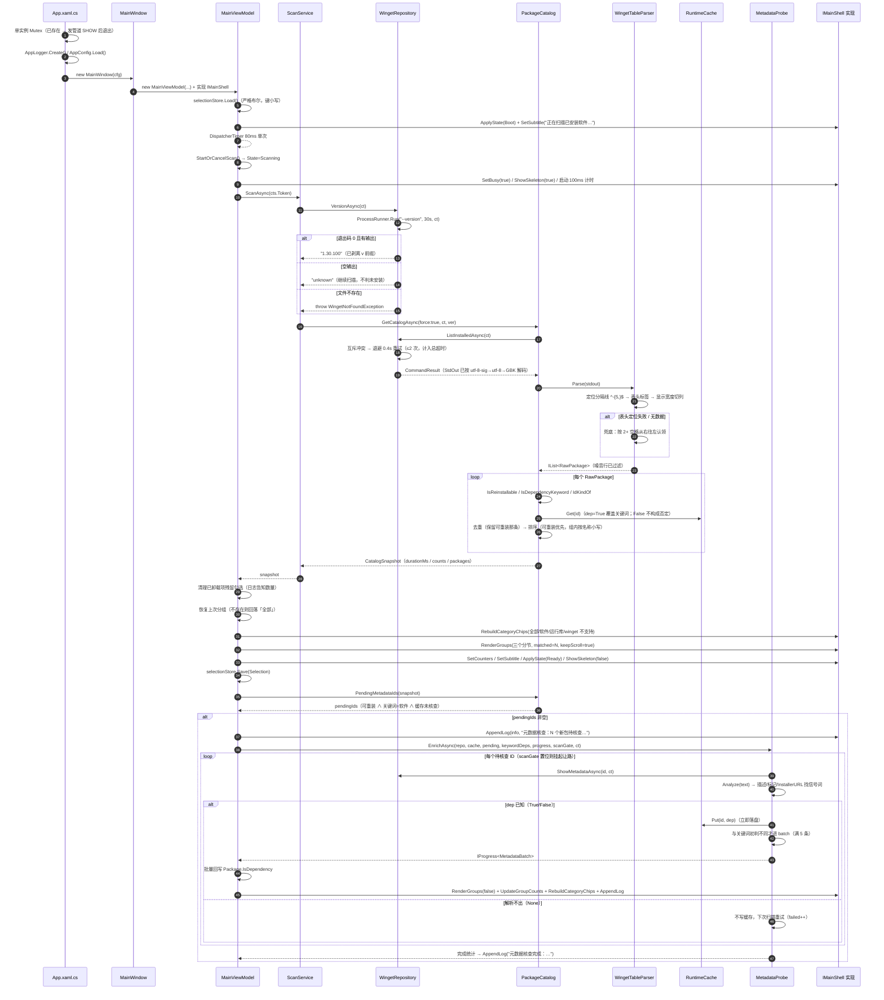
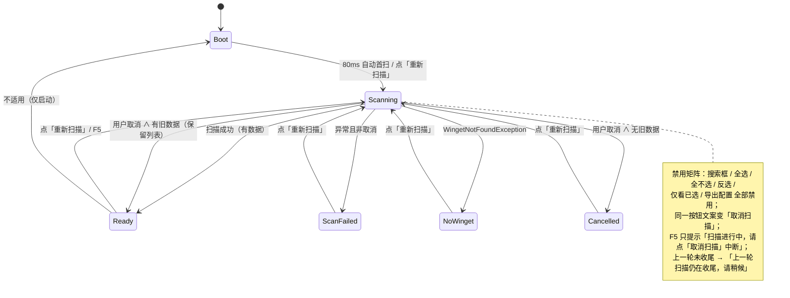
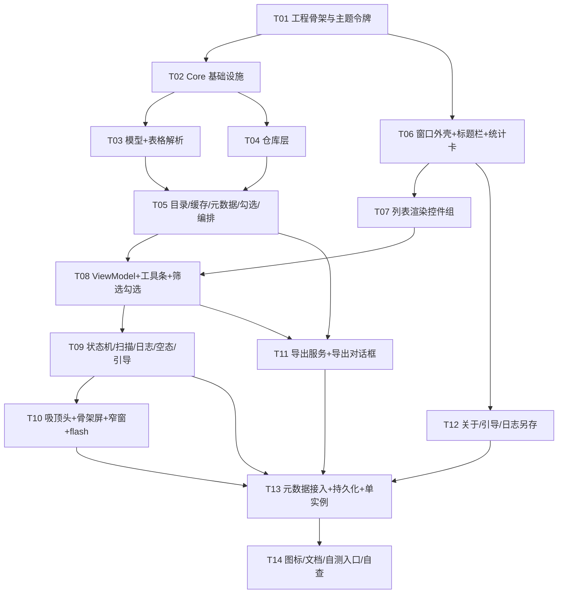

# 架构设计 · WingetManagerWpf（Winget 软件管家 · C#/WPF 复刻版）

> 架构师：高见远 ｜ 对应 PRD v1.0 ｜ 参考实现：`_ref/`（Python 3.14 + PySide6，v2.18.0）
> 目标：C# + WPF + **.NET Framework 4.8**（传统 csproj，`UseWPF`），**零 NuGet 第三方依赖**，功能对等复刻。
> 交付路径：`D:\Program Files\WorkBuddy\winget\WingetManagerWpf\`

---

## 目录

- [Part A · 系统设计](#part-a--系统设计)
  - [1. 实现方案与选型](#1-实现方案与选型)
  - [2. 文件列表](#2-文件列表)
  - [3. 数据结构与接口](#3-数据结构与接口)
  - [4. 程序调用流程](#4-程序调用流程)
  - [5. 存疑与假设](#5-存疑与假设)
- [Part B · 任务分解](#part-b--任务分解)
  - [6. 依赖包](#6-依赖包)
  - [7. 任务列表（14 项 / 5 阶段）](#7-任务列表14-项--5-阶段)
  - [8. 共享知识（跨文件约定）](#8-共享知识跨文件约定)
  - [9. 依赖图](#9-依赖图)
  - [10. 易错点清单（必读）](#10-易错点清单必读)

---

# Part A · 系统设计

## 1. 实现方案与选型

### 1.1 核心难点与结论

| # | 难点 | 结论 / 选型 |
|---|---|---|
| 1 | `winget list` 中文表头 + **显示宽度对齐**（汉字占 2 列）需要用 East Asian Width 切列 | 自写 `EastAsianWidth`（.NET Framework 无此 API）+ 中英表头标签定位 + 「2+ 空格从右往左认领」兜底，逐行 1:1 移植 `services/winget_table.py` |
| 2 | winget 有**进程级全局互斥**（`0x8A150001`，且个别版本只空输出失败） | 退出码比较必须用 `unchecked((int)0x8A150001)`（该值 2316632065 **超出 int 正数范围**）；退避 0.4s、最多 2 次、退避时间计入总超时预算 |
| 3 | 「取消扫描」要求 0.2s 内真正终止子进程 | `Process` + 200ms 轮询 `WaitForExit(200)`；取消 → `Kill()`（**.NET Framework 4.8 没有 `Kill(entireProcessTree)`**，必要时兜底 `taskkill /F /T /PID`） |
| 4 | 输出编码必须按 `utf-8-sig → utf-8 → GBK → 替换` 顺序 | **绝不能设 `StandardOutputEncoding`**（一旦设定就固定编码）。必须**收集原始字节**：`Task.Run` 内起两个并发任务分别把 `BaseStream` 读进 `MemoryStream`，读完再统一解码 |
| 5 | 折叠分组 + 吸顶分组头 + 46px 固定行高 | **`ScrollViewer` + `ItemsControl(StackPanel)` 非虚拟化**，理由见 §1.2 |
| 6 | 无边框圆角窗口 | `WindowStyle=None` + `WindowChrome(CaptionHeight=0, ResizeBorderThickness=7, GlassFrameThickness=0)`，**不启用 `AllowsTransparency`**（黑边/DWM 性能风险），圆角由内层 `Border` 近似 |
| 7 | 零 NuGet 下的 JSON | **自写轻量 `MiniJson`**（约 250 行：`JsonValue` 树 + Writer + Reader），不用 `DataContractJsonSerializer`（键序/缩进不可控）、不用 `JavaScriptSerializer`（转义与日期怪癖） |
| 8 | 三产物编码差异 | `apps.json` = UTF-8 **无 BOM**、2 空格缩进、键序固定；`恢复-*.bat` = **GBK + CRLF**；`无法自动重装清单-*.html` = **UTF-8 无 BOM + CRLF**（编码靠 `meta charset` 声明）。GBK 编码必须用 `EncoderFallback.ExceptionFallback` 才能抛异常（默认会静默替换成 `?`） |

### 1.2 为什么是 StackPanel 而不是 ListBox/虚拟化面板

| 需求 | ListBox + VirtualizingStackPanel | ScrollViewer + StackPanel |
|---|---|---|
| 三个可折叠分组节 | 需要 `CollectionViewSource` 分组 + `GroupStyle` + `IsGrouping` 虚拟化被**自动关闭** | 节就是普通的 `GroupSectionControl`，折叠 = 内层 `Visibility.Collapsed` |
| 分组头内嵌批量勾选按钮、计数胶囊 | 组模板里挂交互控件，事件路由要绕 | 直接 `Click` 事件 |
| 吸顶分组头需要「组在内容坐标系的 Y」 | 虚拟化后未实现容器的 Y 不可知 | 布局完成后 `TransformToAncestor` 一次取稳，`ScrollChanged` 只做比较 |
| 46px 固定行高 | 容器高度由 `Measure` 决定，仍需 `ItemContainerStyle` 固定 | `Height=46` 常量即定 |
| 数据量 | 数百行（原版实测 ~100 条唯一 ID，重建 ~119ms） | 同量级，一次性构建 100~300 行 WPF 控件在 100~200ms 内，可接受 |

**结论**：非虚拟化，配合两条性能纪律 ——
① 构建/重建时 `ItemsControl.BeginInit/EndInit` 包裹，结束后一次性 `InvalidateMeasure`；
② **只改计数不重建**：勾选/全选/反选/胶囊计数变化走 `UpdateCounts()`，仅当「可见集合」变化时才 `RebuildList()`（原版同策略：`_update_all_counts` vs `_rebuild_list`）。

### 1.3 自绘 vs 模板：取舍原则

| 控件 | 实现方式 | 理由 |
|---|---|---|
| `StatCard`（104×70，顶部渐变条 + 渐变数字 + hover 微浮） | `FrameworkElement.OnRender(DrawingContext)` | 纯装饰、无子元素命中测试，`FormattedText/GradientBrush` 一次画完，代码量最小 |
| `CountPill`（20px 高，按勾选比例填充，勾满渐变） | `OnRender` | 需要按比例裁剪的圆角填充，模板做不到 |
| `MiniProgress`（3px 不定进度条） | `OnRender` + `DispatcherTimer` | 同上，且 100ms 重绘开销极小 |
| `CheckBoxEx`（20×20 圆角框 + 勾） | `OnRender` + `MouseLeftButtonDown` | 只有两个视觉状态 |
| `GradientText`（标题/已勾选数字，135° 渐变字） | `OnRender` + `FormattedText` + `DrawingBrush`（或 `TextBlock` + `OpacityMask`） | 文本渐变无法用样式表达 |
| `TitleBarControl` | `Grid` + `TextBlock`/`Button` + `Path` | 需要按钮命中测试、ToolTip、双击最大化 |
| `PackageRowControl` | **`Grid` + `Border` + `Style`** | 需要标签 ToolTip、文本裁剪、焦点描边、右键菜单、`Space/Enter/↑↓` 键盘；模板更稳、更易维护 |
| `GroupHeaderControl` | `Grid` + 内嵌 `CountPill` + 链接 `TextBlock` | 同上 |
| `LogPanelControl` | `RichTextBox`(只读) 或 `ItemsControl` + `Run` 着色 | 原版 `QTextEdit` + `QTextCharFormat` → WPF 用 `FlowDocument` + `Paragraph`/`Run.Foreground`；选 **`RichTextBox` 只读 + `FlowDocument`**（支持选中复制、按行着色、自动滚底） |
| `StickyGroupHeader` | 复用 `GroupHeaderControl`（只读模式）叠放在列表 `Grid` 上层 | 避免二次实现绘制逻辑 |

### 1.4 无边框窗口方案（细化）

```xml
<Window WindowStyle="None"
        ResizeMode="CanResize"
        Background="{StaticResource Brush.BG}"
        MinWidth="940" MinHeight="600" Width="1240" Height="880">
  <WindowChrome.WindowChrome>
    <WindowChrome CaptionHeight="0" ResizeBorderThickness="7"
                  GlassFrameThickness="0" CornerRadius="0" UseAeroCaptionButtons="False"/>
  </WindowChrome.WindowChrome>
  <Border x:Name="RootBorder" CornerRadius="16" Background="{StaticResource Brush.BG}"
          BorderBrush="{StaticResource Brush.LINE}" BorderThickness="1">
    <!-- 8 层结构 -->
  </Border>
</Window>
```

要点：
- `CaptionHeight=0` → 系统不提供标题栏拖动，标题栏自行 `MouseLeftButtonDown → DragMove()`；**`WindowState=Maximized` 时禁止 `DragMove()`**（会抛 `InvalidOperationException`），先 `WindowState=Normal` 再进入拖动。
- 双击标题栏 → 最大化/还原；`StateChanged` 里给 `RootBorder.Margin` 补 `SystemParameters.WindowResizeBorderThickness + WindowNonClientFrameThickness`，消除最大化溢出。
- `AllowsTransparency=False` → 四角为外部直角（矩形窗口），**接受为已知视觉差异**（说明书 FEATURE-MAPPING 记录）。不要设 `Window.CornerRadius`（不存在）。
- 125%/150% DPI：`app.manifest` 声明 `PerMonitorV2`；`UseLayoutRounding=True` + `SnapsToDevicePixels=True` 在根 Border 上开启。

### 1.5 线程模型

- **唯一子进程入口**：`Services/WingetRepository`。全部 `async Task`，内部 `Task.Run` 执行阻塞的 `Process` 逻辑。
- 取消：`CancellationToken`（→ 内部 `ManualResetEvent` 语义，200ms 轮询）。
- 进度回调：`IProgress<T>`（在 UI 线程构造，自动 `SynchronizationContext.Post` 回 UI 线程）。
- **禁止跨线程碰 UI**：ViewModel 内所有 `IMainShell` 调用只允许发生在 UI 线程；后台任务只 `IProgress`/`await` 回来。
- 元数据富化用 `WaitHandle`（`ManualResetEventSlim`）做「扫描闸门」：扫描进行中富化线程每次 `show` 前挂起让路。

### 1.6 架构模式

**轻量 MVVM（无 MVVM 框架）**：
- `ViewModels/MainViewModel`：纯 .NET（仅依赖 `System.dll` 的 `ICommand`），持有全部状态（`AppState`/`Packages`/`Selection`/`SearchTokens`/`ActiveCategory`/`OnlySelected`/`Log`），暴露 `ICommand` 与事件；
- `ViewModels/IMainShell`：**UI 侧能力接口**，由 `MainWindow` 实现。VM 只调接口，不引用任何 WPF 类型 → 可被控制台自测工程链接（QA 用 FakeShell 断言行为）；
- 行/分组视图对象（`PackageRowControl`、`GroupSectionControl`）由 `Views/ListPresenter`（code-behind 帮助类）**命令式构建**，不走 `DataTemplate`/`ItemsSource` 绑定 —— 因为需要「不重建、只改计数」与吸顶头测量，命令式更可控；
- 对话框（导出/关于/引导）为独立 `Window`，与 VM 单向交互（传入快照数据，返回 `DialogResult`）。

---

## 2. 文件列表

> 共 55 个文件（不含 `docs/PRD.md`、QA 自测工程）。`★` = 纯 .NET 文件，**不得出现** `using System.Windows*` / `PresentationFramework` / `WindowsBase`（供 QA 控制台工程 `Compile Include` 链接）。

### 2.1 根目录 / 工程

| 文件 | 职责 |
|---|---|
| `WingetManagerWpf.sln` | 唯一解决方案，含 WPF 主工程（+ 可选 SelfTest 工程） |
| `.gitignore` | `bin/ obj/ .vs/ *.user` |
| `README.md` | 编译步骤（VS2019+/MSBuild）、环境变量、产物说明、已知差异 |
| `WingetManagerWpf/WingetManagerWpf.csproj` ★ | 传统 csproj：`TargetFrameworkVersion v4.8`、`<UseWPF>true</UseWPF>`、`ApplicationManifest`、无 `PackageReference` |
| `WingetManagerWpf/app.manifest` | DPI 感知（PerMonitorV2）+ `requestedExecutionLevel=asInvoker` + 支持 Win10/11 `compatibility` |
| `WingetManagerWpf/App.xaml` | 合并 `Theme/Tokens.xaml` + `Theme/Styles.xaml`；无 `StartupUri`（用代码启动） |
| `WingetManagerWpf/App.xaml.cs` | 单实例 Mutex + 命名管道激活、全局异常兜底、日志初始化、`Main()` 编排 |
| `WingetManagerWpf/AssemblyInfo.cs` | `AssemblyVersion/FileVersion = 2.18.0.0`（与 `Core/AppVersion.cs` 同步） |

### 2.2 `Core/`（无 UI 依赖）

| 文件 | 职责 |
|---|---|
| `Core/AppVersion.cs` ★ | `public const string Version = "2.18.0"`（单一来源，关于框/日志/诊断都用它） |
| `Core/AppPaths.cs` ★ | `%LOCALAPPDATA%\WingetManager` 下 `selection.json` / `metadata-cache.json` / `settings.json` / `logs\app.log`；导出默认路径推导（上次 → `D:\apps.json` → 文档 → 用户目录） |
| `Core/AppConfig.cs` ★ | 读 `WPM_WINGET_EXE` / `WPM_COMMAND_TIMEOUT`(10~3600,180) / `WPM_CACHE_TTL`(0~3600,60) / `WPM_META_TTL_DAYS`(0~3650,90)；`FindWinget()`（env → `PATH` → `%LOCALAPPDATA%\Microsoft\WindowsApps\winget.exe`）；**探测失败不抛到顶层**，记 `WingetError` 供引导 |
| `Core/AppException.cs` ★ | `AppException` + `ConfigInvalidException` / `WingetNotFoundException` / `WingetCommandFailedException` / `ScanCancelledException` / `BadRequestException`；每个带 `UserMessage`（中文可读） |
| `Core/AtomicFile.cs` ★ | `WriteTextAtomic(path, text, Encoding)` / `WriteAllBytesAtomic` / `WriteJsonAtomic`：同目录 `*.tmp` → `FileStream.Flush(true)` → `File.Replace`（无目标时 `File.Move`）→ 失败清理 tmp |
| `Core/AppLogger.cs` ★ | 文件日志（`logs\app.log`，512KB×2 轮转，`yyyy-MM-dd HH:mm:ss [LEVEL] msg`）+ `LogEmitted` 事件（供 UI 日志面板）；数据目录不可写时降级为纯内存 |
| `Core/EncodedText.cs` ★ | `Decode(byte[])` 多编码回退；`DisplayWidth(string)` / `CharWidth`（East Asian Width 表）；`\r\n` 规范化 |
| `Core/Metrics.cs` ★ | 布局常量单一来源：行 46、组头 42、标题栏 52、底栏 58、统计卡 104×70、复选框 20、胶囊 20、版本列 110、日志 90~420（默认 150）、窗口 1240×880 / 最小 940×600、窄窗阈值 1080、边缘缩放 7、圆角 16 |
| `Core/Strings.cs` ★ | **全部中文文案**（与原文逐字对齐）+ 格式化助手（副标题/底栏/空态/日志行） |
| `Core/SettingsStore.cs` ★ | `settings.json` 读写：窗口 X/Y/W/H、最大化、日志高度、日志展开、上次分组、上次导出路径；损坏回退默认值 |
| `Core/Json/JsonValue.cs` ★ | 轻量 JSON 树（Null/Bool/Number/String/Array/Object），严格类型判断（`IsBool`/`TryGetBool`） |
| `Core/Json/JsonWriter.cs` ★ | 输出 2 空格缩进、`\u` 不转义非 ASCII（`ensure_ascii=False` 等价）、键序保留插入顺序、尾随换行 |
| `Core/Json/JsonReader.cs` ★ | 容错解析（容忍 BOM/尾逗号不宽容但给中文报错）；损坏返回 `null` 由调用方回退 |
| `Core/ProcessRunner.cs` ★ | 启动 `Process`（`CreateNoWindow`、`UseShellExecute=false`）、双 `Task` 并发读 stdout/stderr 原始字节、200ms 轮询取消、超时 Kill、返回退出码与字节 |
| `Core/SingleInstance.cs` ★ | `Local\WingetManagerWpf.SingleInstance` Mutex + 命名管道 `WingetManagerWpf.Activate`；第二实例发 `SHOW` 后退出 |

### 2.3 `Models/`（无 UI 依赖）

| 文件 | 职责 |
|---|---|
| `Models/RawPackage.cs` ★ | `winget list` 原始行（Name/PackageId/Version/Available/Source） |
| `Models/Package.cs` ★ | 规范化包（`PackageIdentifier/Name/Version/AvailableVersion/Source/IdKind/Reinstallable/IsDependency`）+ `Key`（小写 ID） |
| `Models/CatalogSnapshot.cs` ★ | 快照（`GeneratedAt/DurationMs/WingetVersion/Machine/Counts/Packages`） |
| `Models/AppSettings.cs` ★ | `settings.json` 的 POCO |
| `Models/ExportResult.cs` ★ | 导出结果（`Files[] / PackageCount / WingetCount / MsStoreCount / UninstallableCount / JsonPath`）+ `SourceBreakdown` |
| `Models/Groups.cs` ★ | 分组常量 `软件` / `运行库` / `winget 不支持` + `GroupOrder` + `GroupRank` + `GroupOf(Package)` |

### 2.4 `Services/`（无 UI 依赖）

| 文件 | 职责 |
|---|---|
| `Services/CommandResult.cs` ★ | `Args/ExitCode/StdOut/StdErr/DurationMs` + `Ok` / `Combined` / `IsMutexConflict` |
| `Services/WingetRepository.cs` ★ | **唯一子进程入口**：`--disable-interactivity --accept-source-agreements` 追加、互斥重试（0.4s×2）、`VersionAsync`（`v` 前缀剥离，空输出 → `unknown`）、`ListInstalledAsync`、`ShowMetadataAsync` |
| `Services/WingetTableParser.cs` ★ | 显示宽度切列解析 + 兜底解析 + 噪音行过滤（逐行移植） |
| `Services/PackageCatalog.cs` ★ | 去重（保留可重装那条）、可重装判定、关键词运行库初判、`IdKind` 推断、排序、计数、`PendingMetadataIds`、内存目录缓存（`WPM_CACHE_TTL`） |
| `Services/RuntimeCache.cs` ★ | `metadata-cache.json`（`{schema:1, entries:{id:{dep,checkedAt}}}`）读写；`dep` 必须 JSON bool；损坏回退空 |
| `Services/MetadataProbe.cs` ★ | `winget show` 输出段落解析（描述/标记/安装器 URL）+ 信号词判定 + 批量富化循环（`BATCH_SIZE=5`、扫描闸门让路） |
| `Services/ScanService.cs` ★ | 编排：`--version`（失败不致命）→ `GetCatalogAsync(force:true)` → 快照；把异常翻译成 `WingetNotFound`/`ScanCancelled`/失败 |
| `Services/SelectionStore.cs` ★ | `selection.json` 读写（严格布尔、键小写、原子写、损坏回退空 + 日志） |
| `Services/ExportProfiles.cs` ★ | `NormalizeWingetVersion` / `BuildManifest` / `SourceBreakdown` / `BuildRestoreBat`(GBK bytes) / `BuildUninstallableList` / `WriteAll`（三产物落盘） |

### 2.5 `ViewModels/`（无 UI 依赖，仅 `System.dll`）

| 文件 | 职责 |
|---|---|
| `ViewModels/ObservableObject.cs` ★ | `INotifyPropertyChanged` + `SetField` |
| `ViewModels/RelayCommand.cs` ★ | `ICommand`（`CanExecute`/`Execute` + 手动 `RaiseCanExecuteChanged`） |
| `ViewModels/LogEntry.cs` ★ | 日志条目（`Time/LogTag/Text`）+ `LogTag` 枚举 |
| `ViewModels/IMainShell.cs` ★ | UI 能力接口（状态、分组渲染、计数、副标题、底栏、flash、日志、骨架屏、空态、引导框、吸顶） |
| `ViewModels/MainViewModel.cs` ★ | 状态机、筛选（搜索 token/分组/仅看已选）、勾选与批量、日志、导出入口、快捷键语义、扫描计时、元数据改判应用、持久化 debounce |

### 2.6 `Views/`（WPF）

| 文件 | 职责 |
|---|---|
| `Views/MainWindow.xaml` | 8 层结构（标题栏/头部/工具条/胶囊/列表卡/日志/底栏）+ 遮罩层（吸顶头、flash） |
| `Views/MainWindow.xaml.cs` | 实现 `IMainShell`；窗口拖动/最大化/窄窗适配；绑定快捷键；右键菜单；吸顶头 `ScrollChanged`；日志面板拖高 |
| `Views/ListPresenter.cs` | 由「可见分组数据」命令式构建/更新 `GroupSectionControl` + `PackageRowControl`，维护 `RowIndex`（key → 行控件）与组位置表（吸顶用） |
| `Views/ExportDialog.xaml(.cs)` | 560px 两页对话框：表单页（路径/更改…/覆盖提示/msstore 提示/主按钮）+ 成功页（✓/文件清单/双提示/打开文件夹/关闭） |
| `Views/AboutDialog.xaml(.cs)` | 版本 2.18.0、复制诊断信息、打开数据文件夹 |
| `Views/WingetGuideDialog.xaml(.cs)` | 三按钮引导（打开应用商店 / 复制下载地址 / 知道了）—— `MessageBox` 无法三按钮自定义，必须自建 |

### 2.7 `Controls/`

| 文件 | 职责 |
|---|---|
| `Controls/TitleBarControl.xaml(.cs)` | 52px：品牌标（`Path`）+ 渐变标题 + ⓘ + `—` `□` `✕`；拖动/双击 |
| `Controls/StatCard.cs` | `OnRender`：104×70 白卡 + 顶部渐变条 + 渐变数字 + hover 浮起 |
| `Controls/CountPill.cs` | `OnRender`：`sel/total` 比例填充，勾满渐变 |
| `Controls/MiniProgress.cs` | `OnRender` + timer：3px 不定进度条 |
| `Controls/CheckBoxEx.cs` | `OnRender`：20×20 复选框（含 disabled 态） |
| `Controls/GradientText.cs` | `OnRender`：渐变文字（标题 19pt / 底栏数字 16pt） |
| `Controls/PackageRowControl.xaml(.cs)` | 46px 行：复选框 + 名称 + 包 ID(Consolas) + 标签 + 右对齐版本列；hover/焦点/分隔线；高亮片段；窄窗隐藏标签与版本 |
| `Controls/GroupHeaderControl.xaml(.cs)` | 36px：折叠三角 + 标题 + `CountPill` + 一个「全选本组 ⇄ 全不选」按钮 |
| `Controls/GroupSectionControl.xaml(.cs)` | 组头 + 内容 `StackPanel`（折叠 = `Visibility.Collapsed`） |
| `Controls/StickyGroupHeader.xaml(.cs)` | 覆盖在滚动视口顶部的浮层组头（含阴影渐变） |
| `Controls/LogPanelControl.xaml(.cs)` | 日志面板：标题行（圆点/运行日志/收起/复制/保存…/清空）+ `RichTextBox` 着色 + 自动滚底 + 拖高条 |
| `Controls/EmptyStatePanel.xaml(.cs)` | 空态（圆形图标 + 多行文案 + 「清除筛选」按钮） |
| `Controls/SkeletonPanel.xaml(.cs)` | 6 行灰块 + `Opacity` 呼吸动画 |

### 2.8 `Theme/`

| 文件 | 职责 |
|---|---|
| `Theme/Tokens.xaml` | 颜色/画刷/字号/圆角/间距资源字典（键名见 §8.2 映射表） |
| `Theme/Styles.xaml` | 主按钮/次按钮/柔和按钮、`TextBox` 搜索框、`ScrollBar`、`ContextMenu`、`ToolTip`、`CheckBox` 复选框样式、玻璃卡样式 |

### 2.9 `docs/`

| 文件 | 职责 |
|---|---|
| `docs/PRD.md` | 已有（产品经理产出） |
| `docs/ARCHITECTURE.md` | 本文档 |
| `docs/class-diagram.mermaid` | 类图（单独文件，便于工具渲染） |
| `docs/sequence-diagram.mermaid` | 时序图 + 状态机（单独文件） |
| `docs/FEATURE-MAPPING.md` | 功能对应关系 + 已知差异（T14 由工程师按下文骨架补全） |

---

## 3. 数据结构与接口

### 3.1 数据模型

```csharp
namespace WingetManagerWpf.Models
{
    public enum IdKind { Winget = 0, Msix = 1, Registry = 2 }

    /// <summary>winget list 的一行原始数据。</summary>
    public sealed class RawPackage
    {
        public string Name        { get; set; }
        public string PackageId   { get; set; }
        public string Version     { get; set; }   // 可能为 ""
        public string Available   { get; set; }   // 「可用」列
        public string Source      { get; set; }   // winget / msstore / ""
    }

    /// <summary>规范化后的包；分组只看 Reinstallable + IsDependency。</summary>
    public sealed class Package
    {
        public string PackageIdentifier { get; set; }   // 原始大小写
        public string Name              { get; set; }   // 空则回落 PackageIdentifier
        public string Version           { get; set; }
        public string AvailableVersion  { get; set; }
        public string Source            { get; set; }
        public IdKind IdKind            { get; set; }
        public bool   Reinstallable     { get; set; }
        public bool   IsDependency      { get; set; }
        public string Key { get; }                      // PackageIdentifier.ToLowerInvariant()
    }

    public sealed class CatalogCounts
    {
        public int Total, Reinstallable, Unsupported;
        public int Dependencies;       // 可重装 ∧ IsDependency（= 界面「运行库 N」= 「运行库」分组行数）
        public int DependenciesAll;    // 全部 IsDependency（含不可重装；JSON 键 dependencies_all）
        // JSON: {total, reinstallable, unsupported, dependencies, dependencies_all}
    }

    public sealed class CatalogSnapshot
    {
        public string GeneratedAt   { get; set; }   // "yyyy-MM-dd'T'HH:mm:sszzz"
        public int    DurationMs    { get; set; }
        public string WingetVersion { get; set; }   // 可能 "unknown"
        public string Hostname      { get; set; }
        public string Os            { get; set; }
        public string Arch          { get; set; }
        public CatalogCounts Counts { get; set; }
        public IList<Package> Packages { get; set; }
    }

    public sealed class AppSettings            // settings.json
    {
        public int  WindowX, WindowY, WindowWidth, WindowHeight;
        public bool Maximized;
        public int  LogHeight;                 // 90~420
        public bool LogExpanded;
        public string Category;                // "" | 软件 | 运行库 | winget 不支持
        public string ExportPath;              // "" 或上次导出完整路径
    }

    public sealed class SourceBreakdown
    {
        public int Winget  { get; set; }
        public int MsStore { get; set; }
        public int Total => Winget + MsStore;     // = 可重装勾选包数
    }

    public sealed class ExportResult
    {
        public IList<string> Files { get; set; }   // 按写入顺序：json / bat / txt
        public int PackageCount        { get; set; }
        public int UninstallableCount  { get; set; }
        public SourceBreakdown Breakdown { get; set; }
        public string JsonPath         { get; set; }
    }
}
```

### 3.2 Core 接口

```csharp
namespace WingetManagerWpf.Core
{
    public static class AppVersion { public const string Version = "2.18.0"; }

    public static class AppPaths
    {
        public static string DataDir   { get; }        // %LOCALAPPDATA%\WingetManager
        public static string LogDir    { get; }
        public static string LogFile   { get; }        // logs\app.log
        public static string SelectionFile     { get; }// selection.json（与原版同路径同格式）
        public static string MetadataCacheFile { get; }// metadata-cache.json（同路径同格式）
        public static string SettingsFile      { get; }// settings.json（已知差异）
        public static string DefaultExportPath(string lastExportPath);  // 上次 → D:\apps.json → 文档 → 用户目录
        public static bool   DataDirWritable { get; }  // 不可写时降级内存态
    }

    public sealed class AppConfig
    {
        public string WingetExe       { get; }   // "" 表示未找到
        public string WingetError     { get; }   // 未找到时的可读原因
        public int    CommandTimeout  { get; }   // 10~3600，默认 180
        public int    CacheTtlSeconds { get; }   // 0~3600，默认 60；0 = 每次都重扫
        public int    MetadataTtlDays { get; }   // 0~3650，默认 90（WPM_META_TTL_DAYS）；0 = 元数据缓存永不过期
        public static AppConfig Load();          // 非法整数/越界 → ConfigInvalidException（中文消息）
    }

    public static class EncodedText
    {
        public static string Decode(byte[] raw);          // utf-8-sig → utf-8 → 本地编码 → gbk → 替换
        public static int    CharWidth(char ch);          // 组合字符 0；Wide/Fullwidth 2；其余 1
        public static int    DisplayWidth(string text);   // 代理对（emoji）按 2 计
    }

    public static class AtomicFile
    {
        public static void WriteTextAtomic(string path, string text, Encoding encoding); // newline 原样保留
        public static void WriteJsonAtomic(string path, JsonValue payload);              // UTF-8 无 BOM + 缩进 2 + 尾随换行
        public static void WriteAllBytesAtomic(string path, byte[] bytes);
    }

    public sealed class AppLogger
    {
        public event Action<DateTime, string, string> LogEmitted;   // (时间, 级别, 文本)
        public void Info(string msg); public void Warn(string msg);
        public void Error(string msg, Exception ex = null); public void Success(string msg);
        public static AppLogger Create();                          // 512KB×2 轮转；失败降级内存
    }

    public sealed class SettingsStore
    {
        public AppSettings Load();        // 损坏/缺失 → 默认值
        public void Save(AppSettings s);  // 原子写；失败只记日志
    }
}
```

### 3.3 Services 接口（**公开方法签名，工程师照此实现**）

```csharp
namespace WingetManagerWpf.Services
{
    public sealed class CommandResult
    {
        public string[] Args      { get; set; }
        public int      ExitCode  { get; set; }      // 注意 0x8A150001 会表现为负数
        public string   StdOut    { get; set; }
        public string   StdErr    { get; set; }
        public int      DurationMs{ get; set; }
        public bool     Ok => ExitCode == 0;
        public string   Combined => StdOut + (string.IsNullOrEmpty(StdErr) ? "" : "\n" + StdErr);
        public bool     IsMutexConflict => ExitCode == unchecked((int)0x8A150001)
                                        || (ExitCode != 0 && string.IsNullOrWhiteSpace(Combined));
    }

    public interface IWingetRepository
    {
        string WingetExe { get; }

        /// <summary>带互斥重试的通用执行；timeout 秒缺省取 AppConfig.CommandTimeout。</summary>
        Task<CommandResult> RunAsync(string[] args, int? timeoutSeconds, CancellationToken ct);

        /// <summary>winget --version；空输出返回 "unknown"；未找到抛 WingetNotFoundException。</summary>
        Task<string> VersionAsync(CancellationToken ct);

        /// <summary>winget list --accept-source-agreements --disable-interactivity（timeout ≥60s）。</summary>
        Task<CommandResult> ListInstalledAsync(CancellationToken ct);

        /// <summary>winget show --id &lt;id&gt; --exact ...（timeout 30s，失败不抛，返回原始结果）。</summary>
        Task<CommandResult> ShowMetadataAsync(string packageId, CancellationToken ct);
    }

    public static class WingetTableParser
    {
        public static IList<RawPackage> Parse(string listOutput);   // 表头定位失败 → 兜底解析
    }

    public sealed class PackageCatalog
    {
        public PackageCatalog(AppConfig cfg, IWingetRepository repo, RuntimeCache cache, AppLogger log);

        /// <summary>force=false 且缓存未过期（CacheTtlSeconds）直接返回上次快照。</summary>
        Task<CatalogSnapshot> GetCatalogAsync(bool force, CancellationToken ct, string wingetVersion);

        /// <summary>可重装 ∧ 关键词判软件 ∧ 缓存未核查 的 ID（顺序同快照，去重）。</summary>
        IList<string> PendingMetadataIds(CatalogSnapshot snapshot);

        // 纯函数（供自测直接断言）
        public static bool IsReinstallable(RawPackage raw);           // Source ∈ {winget, msstore}
        public static bool IsDependencyKeyword(RawPackage raw);       // 19 个关键词，name+id 小写包含
        public static string MatchedDependencyKeyword(string name, string packageId); // 第一个命中的词；未命中 null
        public static IdKind IdKindOf(string packageId);              // msix\ → Msix；含 \ → Registry
    }

    public sealed class RuntimeCache
    {
        public RuntimeCache(string path, AppLogger log, int ttlDays = 90);  // ttlDays<=0 → 永不过期
        public bool? Get(string packageId);            // 键小写；非 JSON bool / 已过期 → 未命中（不删条目）
        public void  Put(string packageId, bool dep);  // 立即落盘（原子写），刷新 checkedAt
        public int   Count { get; }
    }

    public struct RuntimeSignal { public bool? IsDependency; public string SignalWord; }

    public sealed class MetadataChange { public string Id, Name, Signal; public bool Dep; }

    /// <summary>一批改判（最多 5 条）。IsFinal=true 时携带完整统计，供 UI 打收尾日志。</summary>
    public sealed class MetadataBatch
    {
        public IList<MetadataChange> Changes { get; set; }
        public bool IsFinal      { get; set; }
        public bool Canceled     { get; set; }
        public int  Checked      { get; set; }   // 真正发起过 show 的条数
        public int  Promoted     { get; set; }   // 元数据改判为运行库
        public int  Kept         { get; set; }   // 确认为软件
        public int  Failed       { get; set; }   // 拿不到/解析不出，未写缓存
    }

    public static class MetadataProbe
    {
        public static RuntimeSignal Analyze(string showOutput);   // 空/解析不出描述标记 → (null, null)

        /// <summary>批量富化：每 5 条改判回报一批；扫描闸门置位时挂起让路。</summary>
        public static Task EnrichAsync(IWingetRepository repo, RuntimeCache cache,
                                       IEnumerable<string> pendingIds,
                                       IDictionary<string, bool> keywordDeps,
                                       IProgress<MetadataBatch> progress,
                                       ManualResetEventSlim scanGate,
                                       CancellationToken ct);
    }

    public sealed class ScanService
    {
        public ScanService(PackageCatalog catalog, IWingetRepository repo, AppLogger log);
        /// <summary>--version（失败按 unknown 继续）→ GetCatalogAsync(force:true, ct, ver)。</summary>
        Task<CatalogSnapshot> ScanAsync(CancellationToken ct);
        // 异常语义：WingetNotFoundException → NO_WINGET；OperationCanceledException → 取消；其余 → SCAN_FAILED
    }

    public sealed class SelectionStore
    {
        public SelectionStore(string path, AppLogger log);
        public IDictionary<string, bool> Load();                       // 严格布尔，键小写
        public void Save(IDictionary<string, bool> selection);         // 原子写，失败只记日志
    }

    public static class ExportProfiles
    {
        public const string SchemaUrl = "https://aka.ms/winget-packages.schema.2.0.json";

        /// <summary>^v?(\d+(?:\.\d+){1,3}(?:[-+][0-9A-Za-z.\-]+)?) 不匹配 → "1.0.0"。</summary>
        public static string NormalizeWingetVersion(string raw);

        /// <summary>winget import schema 2.0 的 JSON 文本（UTF-8 无 BOM、2 空格缩进、键序固定）。</summary>
        public static string BuildManifest(IEnumerable<Package> selected, string wingetVersion);

        public static SourceBreakdown SourceBreakdown(IEnumerable<Package> selected);

        /// <summary>恢复 bat 的 GBK 字节（CRLF、chcp 936、% 双写、仅取 basename）。GBK 无法表示 → BadRequestException。</summary>
        public static byte[] BuildRestoreBat(string jsonFileName, int count, int msStoreCount);

        /// <summary>无法自动重装清单 HTML（调用方以 UTF-8 无 BOM 写盘）。传全部非可重装包。</summary>
        public static string BuildUninstallableHtml(IEnumerable<Package> packages);

        /// <summary>三产物落盘：apps.json → 恢复-&lt;stem&gt;.bat → 无法自动重装清单-&lt;stem&gt;.html（后者仅当存在非可重装包）。</summary>
        public static ExportResult WriteAll(string jsonPath,
                                            IEnumerable<Package> selected,
                                            IEnumerable<Package> allPackages,
                                            string wingetVersion,
                                            AppLogger log);
    }
}
```

### 3.4 ViewModel 接口

```csharp
namespace WingetManagerWpf.ViewModels
{
    public enum AppState { Boot, Scanning, Ready, ScanFailed, NoWinget, Cancelled }
    public enum LogTag   { Info, Success, Skip, Fail, Done, Error }

    /// <summary>UI 能力接口：由 MainWindow 实现；VM 只调它，因此 VM 无 WPF 依赖。</summary>
    public interface IMainShell
    {
        void ApplyState(AppState state);
        void RenderGroups(IList<GroupView> groups, int matchedCount, bool keepScroll);
        void UpdateGroupCounts();                                   // 只改计数，不重建
        void RebuildCategoryChips(IList<CategoryChip> chips, string activeCategory);
        void SetCounters(int total, int reinstallable, int selected, int dependencies);
        void SetSubtitle(string text);
        void SetStatus(string text);                                // 底栏文案
        void Flash(string text);                                    // 2.2s 后回落到 SetStatus
        void AppendLog(LogEntry entry);
        void ShowEmptyState(string message, bool showClearButton);  // 显示空态页
        void ShowSkeleton(bool visible);
        void SetScanElapsed(TimeSpan elapsed);                       // 100ms tick
        void SetBusy(bool scanning);                                 // 禁用矩阵（搜索/批量/仅看已选/导出）
        void ShowWingetGuide(string detail);                         // NO_WINGET 引导框
        void UpdateStickyHeader(string title, int selected, int total);
        void HideStickyHeader();
        void ScrollToGroup(string title);
        void ShowList();                                             // 切回列表页（stack index 0）
    }

    public sealed class GroupView { public string Title; public bool Expanded; public IList<Package> Packages; public int Selected; }
    public sealed class CategoryChip { public string Text; public string Category; public int Count; }

    public sealed class MainViewModel : ObservableObject
    {
        public MainViewModel(AppConfig cfg, ScanService scan, MetadataProbeHost enrich,
                             SelectionStore selection, SettingsStore settings,
                             AppLogger log, IMainShell shell);

        public AppState State { get; }
        public IList<Package> Packages { get; }
        public IDictionary<string, bool> Selection { get; }

        public ICommand ScanOrCancelCommand { get; }   // 「重新扫描 / 取消扫描」同一按钮
        public ICommand SelectAllCommand { get; }
        public ICommand SelectNoneCommand { get; }
        public ICommand InvertSelectionCommand { get; }
        public ICommand ToggleOnlySelectedCommand { get; }
        public ICommand ExportCommand { get; }
        public ICommand ClearFiltersCommand { get; }

        public void Initialize();                       // 读 selection/settings → BOOT → 80ms 后首扫
        public void StartOrCancelScan();
        public void SetSearchText(string text);         // 130ms 防抖
        public void SelectCategory(string category);    // null = 全部
        public void ToggleRow(Package pkg);
        public void SetGroupSelection(string group, bool? selectAll);   // 组头链接
        public void CopyRowField(Package pkg, RowCopyKind kind);        // 右键菜单
        public void MoveRowFocus(Package current, int delta);
        public void Shutdown();                         // flush selection + 保存 settings + 取消任务
        public void OnExportFinished(ExportResult result);
    }
}
```

### 3.5 类图

```mermaid
classDiagram
    class AppConfig { +WingetExe +WingetError +CommandTimeout +CacheTtlSeconds +Load() }
    class AppPaths { +DataDir +SelectionFile +MetadataCacheFile +SettingsFile +DefaultExportPath() }
    class AtomicFile { +WriteTextAtomic() +WriteJsonAtomic() +WriteAllBytesAtomic() }
    class EncodedText { +Decode(byte[]) +DisplayWidth(string) }
    class AppLogger { +LogEmitted +Info() +Error() +Success() }
    class SettingsStore { +Load() +Save(AppSettings) }

    class RawPackage { +Name +PackageId +Version +Available +Source }
    class Package { +PackageIdentifier +Name +Version +AvailableVersion +Source +IdKind +Reinstallable +IsDependency +Key }
    class CatalogSnapshot { +GeneratedAt +DurationMs +WingetVersion +Packages +Counts }
    class AppSettings { +WindowX +WindowY +LogHeight +LogExpanded +Category +ExportPath }
    class ExportResult { +Files +PackageCount +Breakdown }

    class IWingetRepository { <<interface>> +VersionAsync() +RunAsync() +ListInstalledAsync() +ShowMetadataAsync() }
    class WingetRepository { -AppConfig _cfg -ProcessRunner _runner }
    class ProcessRunner { +RunAsync(exe,args,timeout,ct) }
    class WingetTableParser { +Parse(string) IList~RawPackage~ }
    class PackageCatalog { +GetCatalogAsync(force,ct,ver) +PendingMetadataIds() +IsReinstallable() +IsDependencyKeyword() }
    class RuntimeCache { +Get(id) +Put(id,dep) }
    class MetadataProbe { +Analyze(string) RuntimeSignal +EnrichAsync() }
    class ScanService { +ScanAsync(ct) }
    class SelectionStore { +Load() +Save() }
    class ExportProfiles { +NormalizeWingetVersion() +BuildManifest() +BuildRestoreBat() +BuildUninstallableList() +WriteAll() }

    class MainViewModel { +State +Packages +Selection +Commands +StartOrCancelScan() +SetSearchText() +ToggleRow() +Shutdown() }
    class IMainShell { <<interface>> +ApplyState() +RenderGroups() +UpdateGroupCounts() +SetStatus() +AppendLog() }
    class MainWindow { +IMainShell 实现 }
    class ExportDialog
    class ListPresenter
    class PackageRowControl
    class GroupSectionControl
    class StickyGroupHeader

    AppConfig --> AppPaths
    SettingsStore --> AppSettings
    WingetRepository ..|> IWingetRepository
    WingetRepository --> ProcessRunner
    WingetRepository --> CommandResult
    PackageCatalog --> IWingetRepository
    PackageCatalog --> RuntimeCache
    PackageCatalog --> WingetTableParser
    PackageCatalog --> CatalogSnapshot
    CatalogSnapshot --> Package
    WingetTableParser --> RawPackage
    Package ..> RawPackage : 规范化
    ScanService --> PackageCatalog
    ScanService --> IWingetRepository
    MetadataProbe --> IWingetRepository
    MetadataProbe --> RuntimeCache
    ExportProfiles --> Package
    ExportProfiles --> ExportResult
    ExportProfiles --> AtomicFile
    MainViewModel --> ScanService
    MainViewModel --> MetadataProbe
    MainViewModel --> SelectionStore
    MainViewModel --> ExportProfiles
    MainViewModel ..> IMainShell : 只通过接口驱动 UI
    MainWindow ..|> IMainShell
    MainWindow --> ListPresenter
    ListPresenter --> GroupSectionControl
    GroupSectionControl --> PackageRowControl
    MainWindow --> StickyGroupHeader
    MainWindow --> ExportDialog
    MainWindow --> AppLogger
```



---

## 4. 程序调用流程

### 4.1 启动扫描 → 解析 → 分组 → 呈现 → 元数据核查



### 4.2 导出 → 三产物写盘 → 成功页

```mermaid
sequenceDiagram
    autonumber
    participant User as 用户
    participant MW as MainWindow
    participant VM as MainViewModel
    participant Dlg as ExportDialog
    participant EP as ExportProfiles
    participant AF as AtomicFile
    participant Log as AppLogger

    User->>VM: 点「导出配置」(Ctrl+E) / 主按钮（0 勾选时 disabled）
    VM->>VM: selected = Packages ∩ Selection（全为可重装包）
    VM->>Dlg: new ExportDialog(selected, snapshot.WingetVersion ?? "1.10.0",
    Dlg->>Dlg:                       AppPaths.DefaultExportPath(settings.ExportPath))
    Dlg->>Dlg: SourceBreakdown(selected) → msstore 计数
    Dlg->>Dlg: dest 存在？ → hint 琥珀 + 主按钮「覆盖导出」；否则「立即导出」
    User->>Dlg: 点「更改…」(可选，OpenFileDialog → 强制 .json 后缀)
    User->>Dlg: 点「立即导出 / 覆盖导出」
    Dlg->>Dlg: 禁用主按钮，hint = "正在导出…"
    Dlg->>EP: WriteAll(jsonPath, selected, allPackages, wingetVersion, log)

    EP->>EP: 1) BuildManifest(selected, NormalizeWingetVersion(ver))
    Note over EP: Sources 按 winget / msstore 分组（空组不写）<br/>SourceDetails 固定常量；键序 $schema/CreationDate/Sources/WinGetVersion
    EP->>AF: WriteJsonAtomic(apps.json)  UTF-8 无 BOM + 缩进 2
    EP->>EP: 2) BuildRestoreBat(stem, count=breakdown.Total, msstore)
    Note over EP: GBK 编码（ExceptionFallback）+ CRLF + chcp 936<br/>Path.GetFileName + % 双写
    EP->>AF: WriteAllBytesAtomic(恢复-{stem}.bat)
    EP->>EP: 3) BuildUninstallableList(全部非可重装包)
    Note over EP: 仅当存在非可重装包；单文件 HTML（UTF-8 无 BOM + CRLF）
    EP->>AF: WriteTextAtomic(无法自动重装清单-{stem}.html)
    EP-->>Dlg: ExportResult{Files, Breakdown, UninstallableCount}

    Dlg->>VM: settings.ExportPath = jsonPath; OnExportFinished(result)
    VM->>Log: AppendLog(done, "已导出 N 个软件包：") + 逐文件 info 路径
    alt Breakdown.MsStore > 0
        VM->>Log: AppendLog(skip, "其中 M 个来自 msstore，恢复时可能需登录微软商店")
    end
    Dlg->>Dlg: 切成功页：✓ 徽章 + 文件清单（kind + 文件名 + 完整路径 ToolTip）
    Dlg->>Dlg: +「恢复」提示、「无法自动重装清单」提示、「导出后打开文件夹」勾选行
    User->>Dlg: 点「关闭」
    alt 「导出后打开文件夹」勾选
        Dlg->>Dlg: Explorer 打开 dest 目录（失败静默）
    end
    Dlg-->>MW: DialogResult（模态结束）
```

### 4.3 状态机



### 4.4 列表重建 pseudo（`ListPresenter.Rebuild`）

```
Rebuild(keepScroll):
    visible = []
    for pkg in Packages:
        if ActiveCategory != null and GroupOf(pkg) != ActiveCategory: continue
        if SearchTokens 非空 and not Matches(pkg, SearchTokens): continue
        if OnlySelected and not Selection[pkg.Key]: continue
        visible.add(pkg)

    buckets = 按 GroupOrder 分桶（组内：可重装优先 & 名称小写升序）
    matched = visible.count
    scroll0 = keepScroll ? ScrollViewer.VerticalOffset : 0

    ItemsHost.BeginInit()
    foreach group in buckets where 非空:            # 空组不渲染组头
        section = 复用或新建 GroupSectionControl(group, Expanded[group])
        foreach pkg in buckets[group]:
            row = 复用或新建 PackageRowControl(pkg, Selection[pkg.Key], Narrow)
            row.Highlight = SearchWords           # 命中片段浅黄
        section.UpdateHeader(sel, total)          # 「winget 不支持」不显示全选链接
    ItemsHost.EndInit()

    ScrollViewer.ScrollToVerticalOffset(min(scroll0, ExtentHeight - ViewportHeight))
    UpdateSectionTops()                           # 缓存每个 section 的 Y（吸顶用）
    UpdateSticky()
    UpdateStatus(); UpdateEmptyState()
```

---

## 5. 存疑与假设

| # | 事项 | 处理 / 假设 |
|---|---|---|
| 1 | PRD §P0-F-3 写 `Packages` 含 `PackageIdentifier` / `Version`；**原版只写 `PackageIdentifier`**（`profiles.py:54`） | **按原版实现（只写 PackageIdentifier）**：winget import schema 中 `Version` 可选，写死版本会在该版本从源下架后导致 `--ignore-unavailable` 之外的失败，且与「功能对等 + 产物互通」冲突。记录进 FEATURE-MAPPING「已知差异」。（**已向主理人报备，若要求写 Version 只需加一行**） |
| 2 | 「无法自动重装清单」范围：PRD 文字含糊 | **用全部非可重装包**（`qt_ui.py:1194` 的 `self.app.packages if not p.reinstallable`），不是勾选项。勾选项里不可能有不可重装包 |
| 3 | 分组胶囊是否持久化「全部」 | 原版 `_save_window_state` 写 `view/category`，`None` 存 `""`；恢复时若该组不存在回落「全部」。按此实现 |
| 4 | 日志面板「展开/收起」与「高度」双持久化 | `view/logHeight`（90~420，默认 150）+ `view/logExpanded`；收起时卡片高度固定 34 |
| 5 | 单实例激活方式 | 原版 `QLocalServer`；WPF 用 `Local\` Mutex + 命名管道 `WingetManagerWpf.Activate` 发 `SHOW`，第一实例收到后 `ShowWindow`+`SetForegroundWindow`（行为对等，实现不同，属可接受差异） |
| 6 | 每次 `RuntimeCache.Put` 立即落盘 vs 节流 | 保持原版「立即落盘」（富化线程随时可能被取消，不能攒）；写失败只记日志 |
| 7 | 元数据核查没有 UI 开关 | 已定（主理人裁定 ⑥）：不加开关，与原版对等 |
| 8 | `WPM_CACHE_TTL` 语义 | 主理人裁定 ②：进程内内存缓存，默认 60s，`0` = 每次重扫（`force:true` 时仍绕过） |
| 9 | 骨架屏/吸顶头精度 | 主理人裁定 ④：吸顶做「浮层 + `ScrollChanged` 重算」，骨架做「6 行灰块 + Opacity 呼吸」，不逐帧精修；折叠/胶囊过渡动画列为 P2 可裁剪 |
| 10 | 字体 | 主理人裁定 ⑤：`HarmonyOS Sans SC` → 回退 `Microsoft YaHei UI`（再 `Microsoft YaHei` → `Segoe UI`）；等宽 `Consolas`；在 `App.OnStartup` 探测 `Fonts.SystemFontFamilies` |
| 11 | 打包形态 | 本期只交源码 + 本地编译步骤，不做 PyInstaller 对等物（无安装器） |
| 12 | 沙箱无 MSBuild | 交付前只能做静态校验（XAML/C# 语法自检 + 人工审查 + QA 控制台自测），README 必须写清 `msbuild /t:Restore,Build` 或 VS2022 F5 步骤 |

---

# Part B · 任务分解

> 14 个任务，聚成 **5 个阶段**（A 基础设施 / B 数据层 / C 视图层 / D 导出与对话框 / E 收尾）。
> 顺序执行；同阶段内允许并行（工程师可按依赖自行调整）。
> 每个任务都写明「改哪些文件 + 关键行为 + 验收标准」，验收未过不得进入下一任务。

## 6. 依赖包

**无。零 NuGet 第三方依赖。**

只用 .NET Framework 4.8 自带程序集：

| 程序集 | 用途 |
|---|---|
| `System` | `Process` / `Console` / `ICommand`（`System.Windows.Input.ICommand` 就在 `System.dll`）/ 基础类型 |
| `System.Core` | LINQ / `Task` |
| `System.Xml` | XAML 运行时（`UseWPF` 自动引入） |
| `PresentationCore` / `PresentationFramework` / `WindowsBase` | WPF |
| `System.Xaml` | XAML 解析 |

> ⚠️ `PackageReference` 一条都不许加。JSON 自写（`Core/Json/*`）；测试用 QA 自己的控制台工程（`Compile Include` 链接 `Core/ Models/ Services/ ViewModels/` 的 `*.cs`），不引入 xUnit/NUnit/MSTest。

---

## 7. 任务列表（14 项 / 5 阶段）

### 阶段 A · 基础设施

#### T01 工程骨架与主题令牌
- **源文件**：`WingetManagerWpf.sln`、`WingetManagerWpf/WingetManagerWpf.csproj`、`app.manifest`、`App.xaml(.cs)`、`AssemblyInfo.cs`、`Theme/Tokens.xaml`、`Theme/Styles.xaml`、`Core/AppVersion.cs`、`Core/Metrics.cs`、`Views/MainWindow.xaml(.cs)`（空壳）、`.gitignore`
- **关键行为**
  - 传统 csproj：`TargetFrameworkVersion v4.8`、`<UseWPF>true</UseWPF>`、`ApplicationManifest`、显式 `Compile/Page` 项、`PlatformTarget=x64`（AnyCPU 亦可，但 winget 路径与 MSIX 无差异，取 AnyCPU 更省事）；
  - `app.manifest`：`PerMonitorV2` DPI + `asInvoker`；
  - `Tokens.xaml` 按 §8.2 映射表全量落地（**键名先定死**，后续控件不再自造颜色）；
  - `Styles.xaml` 三类按钮（primary/outline/soft）+ 搜索框 + 竖滚动条 + 右键菜单 + ToolTip；
  - `App.OnStartup`：`ShutdownMode=OnMainWindowClose`，启动空 `MainWindow` 显示 1240×880 窗口；
  - `Metrics.cs` 用 `public const double/int`，XAML 通过 `{x:Static core:Metrics.RowHeight}` 引用（**禁止硬编码重复数字**）。
- **验收**：VS 打开 0 错误 0 警告；F5 出现空白窗口，尺寸 1240×880、最小 940×600；`{StaticResource Brush.Accent}` 可解析；`Tokens.xaml` 键名与 §8.2 表一一对应（QA 脚本比对）。

#### T02 Core 基础设施（无 UI 依赖）
- **源文件**：`Core/AppPaths.cs`、`Core/AppConfig.cs`、`Core/AppException.cs`、`Core/AtomicFile.cs`、`Core/AppLogger.cs`、`Core/EncodedText.cs`（解码部分）、`Core/Strings.cs`（先落 70% 文案）、`Core/SettingsStore.cs`、`Core/Json/JsonValue.cs`、`Core/Json/JsonWriter.cs`、`Core/Json/JsonReader.cs`、`Models/AppSettings.cs`
- **关键行为**
  - `AppPaths`：`%LOCALAPPDATA%\WingetManager`；`DataDirWritable` 用「写临时文件→删」探测；不可写时 `AppLogger` 降级内存；
  - `AppConfig.Load()`：`WPM_COMMAND_TIMEOUT` 越界/非整数 → `ConfigInvalidException`（中文消息，与原文一致）；`WingetExe` 探测失败**只记 `WingetError` 不抛**；
  - `AtomicFile`：同目录 `.tmp` → `Flush(true)` → `File.Replace`（目标不存在用 `File.Move`）→ 异常清理；`WriteJsonAtomic` = UTF-8 无 BOM + 缩进 2 + 尾随 `\n`；
  - `JsonWriter`：保留插入顺序、非 ASCII 原样输出、`\r\n` 等转义正确；
  - `Strings`：副标题、底栏、空态、日志、对话框标题等**逐字对齐原文**（见 §8.5 锚点）。
- **验收**：控制台临时入口跑通 6 条断言 —— ① 原子写覆盖后内容完整；② `JsonWriter→JsonReader` 回环等价；③ 带 BOM 的 JSON 可解析；④ `WPM_COMMAND_TIMEOUT=abc` 抛中文异常；⑤ 日志超 512KB 轮转出 `app.log.1`；⑥ 设置存取回环（含窗口几何与日志高度）。

### 阶段 B · 数据层

#### T03 模型 + 表格解析 + 显示宽度
- **源文件**：`Models/RawPackage.cs`、`Models/Package.cs`、`Models/CatalogSnapshot.cs`、`Models/Groups.cs`、`Models/ExportResult.cs`、`Core/EncodedText.cs`（`DisplayWidth`/`CharWidth` 补齐）、`Services/WingetTableParser.cs`
- **关键行为**
  - `EastAsianWidth`：组合字符（`NonSpacingMark`）=0；Wide/Fullwidth 区段 =2（列出区段表，见 §10-3）；代理对（emoji）整体按 2 计，**不得按 `char` 累加**；
  - 表头标签集合与 `_FIELD_ORDER` 逐字移植；分隔线 `^[-]{5,}$`；
  - 噪音行前缀 7 条（`已找到/找不到/以下/the following/no installed package/没有找到/已安装的程序包`，`StartsWith` 小写比较）；
  - 兜底解析：`\s{2,}` 切分 → 从右往左认领 源(`winget|msstore`) → 版本(`^[0-9v]`) → 可用列；
  - `PackageCatalog.IsReinstallable/IsDependencyKeyword/IdKindOf` 三个纯函数也在此任务一并实现（放 `PackageCatalog` 静态方法）。
- **验收**：内置 6 份样本（中文表头真实输出、英文表头、含噪音行、表头缺失走兜底、空输出、GBK 乱码字节）解析条数与字段全部匹配；`DisplayWidth("名称")==4`、`DisplayWidth("Name")==4`；emoji 名字不越界。

#### T04 仓库层（唯一子进程入口）
- **源文件**：`Core/ProcessRunner.cs`、`Services/CommandResult.cs`、`Services/WingetRepository.cs`
- **关键行为**
  - `ProcessRunner.RunAsync(exe, args, timeoutSec, ct)`：`UseShellExecute=false`、`CreateNoWindow=true`、`RedirectStandardOutput/Error`；**两个 `Task.Run` 并发把 `BaseStream` 读到 `MemoryStream`**（防管道写满死锁）；`WaitForExit(200)` 轮询：`ct.IsCancellationRequested` → `Kill()` → 抛 `ScanCancelledException`；超 `deadline` → `Kill()` → 抛 `WingetCommandFailedException("超时（>Ns，含重试退避）")`；`finally` 里兜底 Kill；
  - 参数拼装：含空格/引号的参数自行加双引号（.NET Framework 无 `ArgumentList`）；
  - 互斥重试：`IsMutexConflict` 判定 + `0.4s` 退避（`ct.WaitHandle.WaitOne(400)`，命中取消立刻抛）+ 最多 2 次 + **退避计入总超时**；
  - 每条命令追加 `--disable-interactivity --accept-source-agreements`；写文件日志（完整命令行 / 退出码 / 耗时 / 重试次数）；
  - `VersionAsync`：`v` 前缀剥离（大小写不敏感）；`Combined` 空 → `unknown`；`ListInstalledAsync` 超时 `max(CommandTimeout,60)`、`cancelled/无输出` → 抛失败；`ShowMetadataAsync` 超时 30s 且**不抛**。
- **验收**：真机 `winget --version` 返回可解析版本；`winget list` 能取消（点取消后 ≤0.5s 返回 `ScanCancelledException`，任务管理器无残留 winget）；把 `WPM_WINGET_EXE` 指向不存在路径 → 中文报错；人为并发两个实例触发互斥 → 日志出现「撞上 winget 互斥，第 N 次重试」。

#### T05 目录 / 缓存 / 元数据 / 勾选存储 / 扫描编排
- **源文件**：`Services/PackageCatalog.cs`、`Services/RuntimeCache.cs`、`Services/MetadataProbe.cs`、`Services/SelectionStore.cs`、`Services/ScanService.cs`
- **关键行为**
  - `GetCatalogAsync`：锁只保护快照字段，**绝不在锁内跑 winget**；`ttl>0 && !force && 未过期` → 直返；
  - 去重键 `id.ToLowerInvariant()`，`previous==null || (!prev.Reinstallable && cur.Reinstallable)` 才替换；
  - `IsDependency = (cacheGet == true) ? true : 关键词初判`（**只补漏不打假**）；
  - 计数口径：`Dependencies` = **可重装 ∧ IsDependency**（与界面「运行库 N」、`Groups.GroupOf` 一致）；
    `DependenciesAll` = 全部 IsDependency（含不可重装），JSON 输出 `counts.dependencies_all`；
  - 刷新日志：`目录刷新完成：N 项（可重装 R 项，关键词命中 K 行[:词×次数, …]）Dms`；K 是**去重前 raw 行数**
    （同 ID 的 x86/x64 两行各计一次），不等于「运行库」分组行数，别拿它对数；无命中时写 `关键词命中 0 行`；
  - 排序 `(!Reinstallable, Name.ToLowerInvariant())`；
  - `PendingMetadataIds`：可重装 ∧ `!IsDependency` ∧ 缓存 null，去重保序；
  - `RuntimeCache`：`{schema:1,entries:{id:{dep,checkedAt}}}`，`dep` 必须 JSON bool（字符串/数字视为未命中），
    `checkedAt` = `yyyy-MM-dd'T'HH:mm:sszzz`，损坏 → 空缓存 + 日志；
    **条目默认 90 天过期**（`WPM_META_TTL_DAYS`，`0` 关闭过期）：`Get` 按 `checkedAt` 判断年龄，
    解析失败/为空视为过期，年龄为负（时钟回拨）视为新鲜，过期只返回 `null` 不删条目（`Put` 才写盘）；
  - `MetadataProbe.Analyze`：段落解析（`描述/Description/标记/标签/Tags/安装程序 URL/Installer URL`，半角/全角冒号，缩进续行）；无描述且无标记 → `(null,null)`；10 个信号词；
  - `EnrichAsync`：每 5 条改判 `IProgress.Report`；`scanGate` 置位时 `WaitOne(200)` 循环让路；取消抛 `ScanCancelledException`；`finally` flush 剩余批次 + 报完成统计；
  - `SelectionStore.Load`：严格布尔（`true` 或 字符串 ∈ `{1,true,yes,on}`），其余一律 `false`；键小写；损坏回退空 + 日志。
- **验收**：真机扫描得到与副标题一致的三个计数（`counts.dependencies` 与界面「运行库 N」必须相等，`dependencies_all` ≥ 它）；把原版 Python 生成的 `selection.json` / `metadata-cache.json` 拷进 `%LOCALAPPDATA%\WingetManager` 能被正确读取（**双向互通**）；把 `metadata-cache.json` 改成 `{"schema":1,"entries":{"x":{"dep":"true","checkedAt":"…"}}}` → 该条视为未命中且不崩；把某条 `checkedAt` 改成 100 天前 → 该条视为未命中（`WPM_META_TTL_DAYS=0` 时仍命中）；`WPM_CACHE_TTL=0` 时连续两次扫描都真的调用 winget（看日志）。

### 阶段 C · 视图层

#### T06 窗口外壳：无边框窗口 + 标题栏 + 头部统计卡
- **源文件**：`Views/MainWindow.xaml(.cs)`（8 层骨架 + `WindowChrome`）、`Controls/TitleBarControl.xaml(.cs)`、`Controls/GradientText.cs`、`Controls/StatCard.cs`、`Core/Strings.cs`（标题/副标题）
- **关键行为**
  - `WindowStyle=None` + `WindowChrome(CaptionHeight=0, ResizeBorderThickness=7, GlassFrameThickness=0)` + `AllowsTransparency=False`；内层 `Border CornerRadius=16`；
  - 标题栏 52px：品牌标（`Path` 内嵌矢量）+ `GradientText("Winget 软件管家")` + ⓘ + `—` `□` `✕`；`MouseLeftButtonDown → DragMove()`（最大化时先还原）；双击切换最大化；`StateChanged` 修 `RootBorder.Margin`；
  - 头部区：左 标题 + 副标题（`MUTED 9pt`），右 4 张 `StatCard`（已安装/可重装★/已勾选★/运行库），间距 8；
  - `StatCard.OnRender`：白卡 + 1px `LINE` 描边 + 圆角 12 + 顶部 3px 渐变条 + 12pt/18pt 数字（高亮卡用渐变字）+ hover 上浮 2px（`RenderTransform`）。
- **验收**：窗口无系统标题栏但可拖动/双击最大化/四边缩放（7px）；最大化不溢出屏幕；125% DPI 下无模糊；四张卡显示 0 且 hover 有位移；ⓘ 点击（暂）弹出占位。

#### T07 列表渲染控件组
- **源文件**：`Controls/PackageRowControl.xaml(.cs)`、`Controls/GroupHeaderControl.xaml(.cs)`、`Controls/GroupSectionControl.xaml(.cs)`、`Controls/CountPill.cs`、`Controls/CheckBoxEx.cs`、`Controls/MiniProgress.cs`、`Views/ListPresenter.cs`、`Views/MainWindow.xaml`（列表卡宿主）
- **关键行为**
  - 列表卡：`ScrollViewer`（`VerticalScrollBarVisibility=Auto`，竖向滚动条 10px 圆角）+ `ItemsControl`(`StackPanel`)；上方 `MiniProgress`（3px，默认 Collapsed）；
  - 行 46px：`16` 左 padding → 复选框 20 → 13 间距 → 名称(10pt/500) + 包 ID(Consolas 8.5pt) → 标签 → 14 → 版本列 110 右对齐(Consolas 9pt，空显示 `—`，前缀 `v`)；
  - 不可重装行：名称 `NAME_OFF`、ID `ID_OFF`、无复选框（用 31px 占位对齐）、`Cursor=Arrow`、标签「不可重装」灰；
  - 标签：`不可重装` 灰 / `运行库` 琥珀(6px 圆角 2x7 padding 8pt) / 来源 `winget`·`msstore` 紫；
  - hover `ROW_HOVER`、焦点描边 `ACCENT`、底部分隔线 `LINE_SOFT`；名称/ID 支持**命中片段浅黄高亮**（`TextBlock.Inlines` 逐段 `Run`，高亮 `#FDE68A` 底 `#7C2D12` 字 600）；
  - 分组头 42px：折叠三角 18px（旋转 0°/90°，简化可无动画）+ 标题 9.5pt/600 + `CountPill` + 「全选本组 / 全不选」（不可勾选组隐藏）；`CountPill` 20px 高、比例填充、勾满渐变描边；
  - `GroupSectionControl`：折叠 = 内容 `Visibility.Collapsed`（P2 才做高度动画）；
  - `ListPresenter.Rebuild/UpdateCounts` 按 §4.4 伪码；`RowIndex`（key→行）+ `SectionTops`（title→Y，吸顶用）。
- **验收**：给 5 个假包（可重装软件 / 运行库 / 不可重装 / 无版本号 / 超长名称）→ 三组正确渲染、空组无组头、折叠展开正常、长名称被裁剪不撑宽、搜索词高亮正确；窗口 <1080 时标签与版本列隐藏而复选框与名称保留；100 行重建 < 300ms。

#### T08 ViewModel + 工具条 + 筛选/勾选/批量/持久化
- **源文件**：`ViewModels/ObservableObject.cs`、`ViewModels/RelayCommand.cs`、`ViewModels/LogEntry.cs`、`ViewModels/IMainShell.cs`、`ViewModels/MainViewModel.cs`、`Views/MainWindow.xaml`（工具条 + 胶囊行 + 底栏）、`Views/MainWindow.xaml.cs`（`IMainShell` 实现 + 快捷键 + 右键菜单）、`Core/Strings.cs`（补齐）
- **关键行为**
  - 工具条（玻璃卡 16px 圆角，`rgba(255,255,255,0.78)` 静态画刷 + 1px 描边 + 轻阴影）：搜索框（高 38，圆角 10，前置放大镜 `Path`，占位「搜索名称或包 ID（空格分隔多个词）」）+ 「重新扫描/取消扫描」(96 宽 outline) + 「仅看已选」(toggle) + 全选/全不选/反选(soft 34 高)；
  - 胶囊行（横向 `ScrollViewer`，高 32）：`全部 N` / `软件 n` / `运行库 n` / `winget 不支持 n`，单选，选中渐变填充白字；
  - 底栏 58px：左状态文案 + 右「渐变数字 / R 项已勾选」+「导出配置」主按钮；
  - 搜索：130ms 防抖；`空格` 分词 AND；`id:` / `name:` 前缀；`Esc` 清空（焦点在框内）或清全部筛选；
  - 勾选语义：`_scoped_packages` 等价实现（有任一筛选 → 当前可见可勾选行；无筛选 → 全部可重装包）；批量后 flash「已全选当前 N 项」/「已取消选中当前 N 项」/「已反选当前 N 项」；
  - 「仅看已选」：勾选空时提示「还没有勾选任何软件 / 取消「仅看已选」可继续浏览并勾选」；该模式下取消勾选**行立即消失**；
  - 行交互：`Space` 切勾选、`Enter` 复制包 ID、`↑`/`↓` 移动当前行并 `BringIntoView`；右键菜单 5 项（复制包 ID / 复制软件名称 / 复制「名称 (包ID)」/ 复制安装命令 / 勾选·取消勾选；不可重装行不显示「复制安装命令」）；
  - 快捷键：`Ctrl+F` 聚焦搜索、`Ctrl+A`（焦点在搜索框内 → 全选文字，否则全选软件）、`Ctrl+Shift+A` 全不选、`Ctrl+I` 反选、`Ctrl+E` 导出、`F5` 重扫、`Esc` 清筛选；
  - 勾选写盘 debounce 300ms（`DispatcherTimer`）+ `Shutdown` 强制 flush。
- **验收**：假数据（30 个包，混合三组）下：搜索 + 分组 + 仅看已选三者交集正确；批量操作只影响当前可见；`Ctrl+A` 在搜索框内是选文字；勾选后 300ms `selection.json` 更新且内容为 `{"id": true}` 严格布尔；重启程序勾选恢复。

#### T09 状态机 / 真实扫描 / 日志面板 / 空态 / 引导
- **源文件**：`Services/ScanService.cs`（接线）、`ViewModels/MainViewModel.cs`（状态机 + 计时 + 取消 + 防重入）、`Controls/LogPanelControl.xaml(.cs)`、`Controls/EmptyStatePanel.xaml(.cs)`、`Views/WingetGuideDialog.xaml(.cs)`、`Views/MainWindow.xaml(.cs)`（日志宿主 + 空态/列表切换）
- **关键行为**
  - 状态机严格按 §4.3；`SetBusy(scanning)` 统一驱动禁用矩阵（搜索/批量/仅看已选/导出）；扫描中按钮文案「取消扫描」；
  - 80ms 后自动首扫；100ms tick 更新 `正在扫描 · 已用 X.Xs · 点「取消扫描」可中断等待`；`MiniProgress` 可见；
  - 取消：`cts.Cancel()` → 状态 `Ready`(有旧数据) / `Cancelled`；flash「已取消扫描 · 稍候可重新扫描」；`F5` 扫描中只 flash「扫描进行中，请点「取消扫描」中断」；防重入 flash「上一轮扫描仍在收尾，请稍候」；
  - 失败不弹模态：`ScanFailed` + 保留旧数据 + 日志 error；`WingetNotFoundException` → `NoWinget` + `WingetGuideDialog`（打开应用商店 `ms-windows-store://pdp/?ProductId=9NBLGGH4NNS1` / 复制 `https://github.com/microsoft/winget-cli/releases` / 知道了）；
  - 日志面板：标题行（6px 圆点 + 「运行日志」+ 收起|展开 + 复制 + 保存… + 清空）；条目 `HH:mm:ss` 时间戳 `LOG_TS` + 正文按 tag 着色（info `LOG_FG` / success `LOG_OK` / skip `LOG_SKIP` / fail|error `LOG_FAIL` / done `LOG_DONE` 加粗）；**用户手动上滚时不强制滚底**（判 `VerticalOffset >= ExtentHeight - ViewportHeight - 4`）；拖高 90~420（上沿 9px 抓手，`Cursor=SizeNS`）、双击折叠，高度与展开态进 `settings.json`；
  - 空态文案按 `Strings` 六种分支（NoWinget / Cancelled / ScanFailed / 扫描中 / 未发现可重装的软件 / 搜索无结果），搜索无结果时显示「清除筛选」按钮。
- **验收**：真机端到端 —— 启动 → 骨架屏 → 列表 → 副标题与计数正确；点取消 ≤0.5s 回到 `Ready` 且日志有 skip 行；把 `WPM_WINGET_EXE` 指向乱路径 → `NoWinget` + 引导框三按钮可用；日志复制/保存/清空/拖高/双击折叠全部正常；扫描中所有批量按钮 disabled。

#### T10 吸顶分组头 + 骨架屏呼吸 + 窄窗适配 + flash
- **源文件**：`Controls/StickyGroupHeader.xaml(.cs)`、`Controls/SkeletonPanel.xaml(.cs)`、`Views/MainWindow.xaml(.cs)`（`ScrollChanged` / `SizeChanged` / flash 层）
- **关键行为**
  - 吸顶：列表卡用 `Grid`（`ScrollViewer` + 覆盖的 `Canvas`），`StickyGroupHeader` 高 42 + 下方 10px 渐变阴影；`ScrollChanged` 用**缓存的分组 Y 表**二分找当前组；若下一组头顶部 < 42 → `Canvas.Top = nextTop - 42`（推入效果）；未滚过第一组头 → 隐藏；内容区非列表页（空态/骨架）→ 隐藏；点击吸顶头 → `ScrollToVerticalOffset(该组 Y)`；
  - 骨架屏：6 行（38×38 圆角灰块 + 230~310×11 标题条 + 140~170×9 副条），`SKEL_1/SKEL_2`；`Opacity` 1.0→0.45→1.0，`Duration=900ms`，`AutoReverse`，仅在 `Boot/Scanning` 且无数据时显示；
  - 窄窗：`SizeChanged` 判 `Width < 1080` → 行隐藏标签与版本列（行内元素 `Visibility`，**不重建行**）；
  - flash：底栏上方浮层提示条（或直接复用底栏文案 + 2200ms 定时器回落 `SetStatus`）。
- **验收**：滚动长列表时浮层组头内容随当前组切换、被下一组顶上去、点击回到组首；骨架屏在扫描期间呼吸、结束后消失且 Stopwatch 不残留（无 CPU 占用）；窗口从 1240 缩到 940 时标签列隐藏、勾选与名称列不错位。

### 阶段 D · 导出与对话框

#### T11 导出服务 + 导出对话框
- **源文件**：`Services/ExportProfiles.cs`、`Views/ExportDialog.xaml(.cs)`、`Core/Strings.cs`（导出文案）
- **关键行为**
  - `BuildManifest`：键序严格 `$schema` → `CreationDate` → `Sources` → `WinGetVersion`；`CreationDate` = `DateTimeOffset.Now.ToString("yyyy-MM-dd'T'HH:mm:ss.fffzzz")`；`Sources` 按 `winget`/`msstore` **字典序**（`winget` < `msstore` 按原版 `sorted()`，即 `msstore` 在前！**按原版 `sorted(by_source.items())` 的字典序 = `msstore` 先**）；空组不写；`Packages` 只含 `PackageIdentifier`（见 §5-1）；
  - `BuildRestoreBat`：文本模板逐行对齐 `_render_restore_bat`（`@echo off` / `chcp 936 >nul` / `title 恢复软件清单` / `cd /d "%~dp0"` / `where winget` 检查 / `net session` 管理员检查 / 提示语 / `winget import -i "%~dp0<name>" --accept-package-agreements --accept-source-agreements --ignore-unavailable` / `pause`）；`Path.GetFileName` + `%`→`%%`；GBK 编码用 `Encoding.GetEncoding(936, EncoderFallback.ExceptionFallback, DecoderFallback.ExceptionFallback)`，抛 `BadRequestException("文件名里有 emoji 等 GBK 无法表示的字符，请改用中文/英文/数字后重试。")`；`\r\n` 连接 + 结尾 `\r\n`；
  - `BuildUninstallableHtml`：**单文件 HTML**（原版是 txt，本项目有意改版）。为什么不用 txt：这份东西唯一的用途是「重装后照着把软件一个个装回来」，纯文本只能给「名称 + 版本」，说不出「还剩几个没装」「哪些其实不用装」。HTML 把进度条、可勾选待办、按用途分节、搜官网按钮、打印样式全部做成现成的。结构：`<h1>` + meta（导出时间 / 总数）+ 三张统计卡（待装 / 已装好 / 完成度）+ 进度条 + 筛选（全部/未装/已装）+ 搜索框 + 两节（普通软件 / 系统组件·运行库，后者带「多数不用单独装」提示）+ `<li class="item">`（`input[type=checkbox][data-key]` + 名称 + 版本 + 类型标签 + `搜官网` 链接）+ footer（清空勾选）。**类型标签三态**：`商店应用`（IdKind.Msix）/ `无独立安装包`（Registry，默认情况，不再逐项写说明）/ `源不可用`（winget 形态，附「可按 ID 搜官方下载页：<id>」）。**三条硬约束**：①单文件零外部资源（CSS/JS 内联、图标用字符）—— 新机器常常没网；②勾选存 `localStorage['wpm.uninstallable.'+key]`，全部操作包 `try/catch`（`file://` 下个别浏览器禁止 localStorage，不能因此让整页脚本挂掉）；③所有用户数据过 `HtmlText()` 转义（`&` 必须第一个换，否则会二次转义）。`data-name`（搜索用）只放名称+版本，**内部路径（`ARP\…`/`msix\…`）只留在 data-key 里当存储键，不作为可见文本**。不做列对齐、不引用外部字体；打印时隐藏交互元素、`li` 加 `break-inside:avoid`；
  - `WriteAll`：`apps.json` → bat（失败仅记 fail 日志**不中断**）→ txt（`allPackages` 无不可重装包时跳过；失败仅记日志）；
  - 对话框 560px：表单页（渐变标题「导出配置」+ 9pt 灰描述含勾选数 + 路径行 `TextBox`(只读，Consolas 8.6pt, 高 36) + 「更改…」+ hint 行 + 「取消」/主按钮 38 高）；目标已存在 → hint 琥珀 `WARN` + 主按钮文案「覆盖导出」；否则 `MUTED2` + 「立即导出」；含 msstore → hint 追加 `· 含 M 个 msstore 包（恢复时可能需登录商店）`；
  - 成功页：46×46 渐变 ✓ 徽章 + 「已导出 N 个软件包」+ 文件清单（`清单文件/恢复脚本/待装页面` + 文件名，ToolTip 全路径，Consolas 8.5pt）+ 双提示语（有 bat → 「重装系统后不必记命令 —— 双击「恢复软件.bat」…」；有 html → 「「无法自动重装清单.html」是那份软件的手动待办页…」）+ 「导出后打开文件夹」（默认勾选）+ 「关闭」；
  - 非法文件名（含 `<>:"/\|?*`）就地校验 → 主按钮 disabled + 红字提示。
- **验收**：三产物用十六进制/文本工具核对 —— `apps.json` 无 BOM、缩进 2、中文不转义、`WinGetVersion` 数字开头；bat 为 GBK 编码且 CRLF（`file`/`xxd` 验证）、`chcp 936`、`%` 已双写、双击真机能跑；txt 带 BOM；同目录三个文件名 stem 一致；覆盖已存在文件时主按钮文案为「覆盖导出」；msstore 包能出现在成功页提示。

#### T12 关于对话框 + 完整引导 + 日志另存
- **源文件**：`Views/AboutDialog.xaml(.cs)`、`Views/WingetGuideDialog.xaml(.cs)`（若 T09 未完成则在此收口）、`Views/MainWindow.xaml.cs`（日志「保存…」）、`Core/Strings.cs`（诊断文案）
- **关键行为**
  - 关于框 560px：44×44 渐变图标 + 「Winget 软件管家」+ `版本 2.18.0`（取 `AppVersion.Version`，**单一来源**）+ 说明行 + 三按钮（复制诊断信息 / 打开数据文件夹 / 关闭）；
  - 诊断信息内容：版本、winget 版本、OS 版本、架构、数据目录、勾选数、包数、日志尾部摘要（≥ 8 行）；
  - 「打开数据文件夹」→ `Process.Start("explorer.exe", AppPaths.DataDir)`；
  - 日志「保存…」→ `SaveFileDialog`（默认 `用户目录\winget-manager-yyyyMMdd-HHmm.log`）→ UTF-8 写盘 → flash「日志已保存：xxx.log」；空日志 → flash「日志还是空的」。
- **验收**：关于框版本与 `AssemblyInfo` 一致；复制诊断信息后能粘贴出完整可用内容；打开数据文件夹能定位；日志保存成功/失败/空三种路径文案正确。

#### T13 元数据核查接入 + 持久化收尾 + 单实例
- **源文件**：`ViewModels/MainViewModel.cs`（富化接线 + `Shutdown`）、`App.xaml.cs`（单实例 + 全局异常兜底 + 字体探测）、`Core/SingleInstance.cs`、`Core/SettingsStore.cs`（补齐字段）、`Views/MainWindow.xaml.cs`（窗口几何保存/恢复）
- **关键行为**
  - 富化：扫描成功后 `PendingMetadataIds` → `MetadataProbe.EnrichAsync`（`IProgress` 回 UI）；每批：回写 `IsDependency` → `RenderGroups(keepScroll:true)` + `UpdateGroupCounts` + `RebuildCategoryChips` + 逐条日志（`归入「运行库」/「软件」（描述/标记命中「xxx」/未见运行库信号）`）；新扫描启动前先取消富化；完成日志「元数据核查完成：N 个新包，a 个归入运行库，b 个确认为软件，c 个暂无法判定（下次扫描自动重试）。」；被打断日志「元数据核查被新扫描打断：…」；
  - 持久化：窗口 X/Y/W/H（非最大化时）、最大化、日志高度、日志展开、分组、导出路径 → `settings.json`；恢复时几何越界（超出虚拟屏）回落居中；分组不存在回落「全部」；
  - 单实例：`Local\WingetManagerWpf.SingleInstance` Mutex + 管道；第二实例发 `SHOW` → 第一实例 `WindowState=Normal` + `Activate()` + `SetForegroundWindow`；
  - 全局兜底：`DispatcherUnhandledException` / `AppDomain.UnhandledException` / `TaskScheduler.UnobservedTaskException` 全部写日志（不弹框，避免二次崩溃）；字体回退探测。
- **验收**：首扫后日志出现「元数据核查：N 个新包待核查」并在数秒内逐批改判、分组胶囊计数变化；`metadata-cache.json` 生成且 `dep` 为 JSON bool；重启后窗口位置/日志高度/分组全部还原；双击 exe 第二次只把已有窗口提到前台；关窗时 `selection.json` 已 flush、无残留 winget 进程、无未捕获异常弹框。

### 阶段 E · 收尾

#### T14 图标 / 文档 / 自测入口 / 全量自查
- **源文件**：`WingetManagerWpf/Assets/app.ico`、`WingetManagerWpf.csproj`（`ApplicationIcon`）、`README.md`、`docs/FEATURE-MAPPING.md`、`docs/ARCHITECTURE.md`（回填实际实现偏差）、`AssemblyInfo.cs`
- **关键行为**
  - 图标：用 `Controls/BrandMark` 相同的矢量几何（实心下箭头 + 圆角托盘 + 渐变圆角方）导出 256/64/48/32/16 多尺寸 `.ico`；
  - `README.md`：环境要求（.NET Framework 4.8 + Win10 1809+）、编译（VS2022 打开 F5 / `msbuild WingetManagerWpf.sln /t:Restore,Build`）、环境变量三件套、产物示例、数据文件位置与兼容说明、**未在本机编译的声明**；
  - `FEATURE-MAPPING.md`：按 PRD §5 表格逐行对照「Python 模块 → WPF 承载文件 → 行为是否对等 → 验证方式」+ 已知差异 8 条（settings.json 位置、玻璃模糊近似、圆角外直角、线程模型、单实例机制、打包形态、WinGetVersion 不写 Version、字体回退）；
  - 全量自查：`grep -r "using System.Windows" Core/ Services/ Models/ ViewModels/` 应为空（保证 QA 控制台工程可链接）；`Metrics` 常量无重复硬编码；`Tokens.xaml` 键全部被使用或标注保留。
- **验收**：exe 带图标；README 按步骤能被第三方机器复现编译；FEATURE-MAPPING 每条差异都有明确「否/近似」标注；§10 易错点清单逐条打勾确认（工程师在 PR 描述里贴勾选清单）。

---

## 8. 共享知识（跨文件约定）

### 8.1 命名空间与分层纪律

```
WingetManagerWpf                → App.xaml.cs、AssemblyInfo
WingetManagerWpf.Core           → AppVersion/AppPaths/AppConfig/AppException/AtomicFile/AppLogger/
                                  EncodedText/Metrics/Strings/SettingsStore/SingleInstance/ProcessRunner/Json
WingetManagerWpf.Models         → RawPackage/Package/CatalogSnapshot/AppSettings/ExportResult/Groups
WingetManagerWpf.Services       → WingetRepository/WingetTableParser/PackageCatalog/RuntimeCache/
                                  MetadataProbe/ScanService/SelectionStore/ExportProfiles/CommandResult
WingetManagerWpf.ViewModels     → ObservableObject/RelayCommand/LogEntry/IMainShell/MainViewModel
WingetManagerWpf.Views          → MainWindow/ListPresenter/ExportDialog/AboutDialog/WingetGuideDialog
WingetManagerWpf.Controls       → TitleBarControl/StatCard/CountPill/CheckBoxEx/MiniProgress/GradientText/
                                  PackageRowControl/GroupHeaderControl/GroupSectionControl/StickyGroupHeader/
                                  LogPanelControl/EmptyStatePanel/SkeletonPanel
```

**硬纪律**：`Core/ Models/ Services/ ViewModels/` **禁止** `using System.Windows` / `System.Windows.Controls` / `PresentationFramework` / `WindowsBase` / `System.Windows.Media`。
唯一允许的是 `System.Windows.Input.ICommand`（在 `System.dll`）与 `System.ComponentModel.INotifyPropertyChanged`（`System.dll`）。

### 8.2 设计令牌映射表（`qt_common.py` → `Theme/Tokens.xaml`）

| Python 常量 | 值 | XAML 键 | 类型 |
|---|---|---|---|
| `BG` | `#F4F5FA` | `Brush.BG` | SolidColorBrush |
| `CARD` | `#FFFFFF` | `Brush.CARD` | |
| `LINE` | `#E8EAF3` | `Brush.LINE` | |
| `LINE_SOFT` | `#F1F2F8` | `Brush.LINE_SOFT` | |
| `TEXT` | `#181C28` | `Brush.TEXT` | |
| `MUTED` | `#6A7183` | `Brush.MUTED` | |
| `MUTED2` | `#9AA1B5` | `Brush.MUTED2` | |
| `MUTED3` | `#C3C8D8` | `Brush.MUTED3` | |
| `ACCENT` | `#6366F1` | `Brush.ACCENT` / `Color.ACCENT` | |
| `ACCENT_2` | `#8B5CF6` | `Brush.ACCENT_2` | |
| `ACCENT_DEEP` | `#4F46E5` | `Brush.ACCENT_DEEP` | |
| `ACCENT_SOFT` | `#EEF0FF` | `Brush.ACCENT_SOFT` | |
| `ACCENT_LINE` | `#D9DCFF` | `Brush.ACCENT_LINE` | |
| `WARN` / `WARN_BG` / `WARN_LINE` | `#B45309` / `#FFF8E8` / `#F5E2BB` | `Brush.WARN` / `Brush.WARN_BG` / `Brush.WARN_LINE` | |
| `ERR` | `#C53030` | `Brush.ERR` | |
| `LOG_BG` / `LOG_FG` / `LOG_TS` / `LOG_HEAD` / `LOG_ACT` / `LOG_SEL` | `#FBFCFE` / `#39404F` / `#A6ADBE` / `#6A7183` / `#8A93A6` / `#E4E8FF` | `Brush.LOG_BG` … `Brush.LOG_SEL` | |
| `LOG_OK` / `LOG_SKIP` / `LOG_FAIL` / `LOG_DONE` / `LOG_SCROLL` | `#0B7A55` / `#6D4FD0` / `#C53030` / `#4F46E5` / `#DCE0EC` | `Brush.LOG_OK` … `Brush.LOG_SCROLL` | |
| `SURFACE` / `SURFACE_2` / `SURFACE_3` | `#FFFFFF` / `#FAFBFD` / `#FAFBFE` | `Brush.SURFACE` / `Brush.SURFACE_2` / `Brush.SURFACE_3` | |
| `BORDER_HOVER` | `#CDD2E2` | `Brush.BORDER_HOVER` | |
| `ROW_HOVER` / `ROW_ALT` | `#F7F8FE` / `#E9EBF4` | `Brush.ROW_HOVER` / `Brush.ROW_ALT` | |
| `NAME_OFF` / `ID_OFF` | `#A9B1C0` / `#C3C9D6` | `Brush.NAME_OFF` / `Brush.ID_OFF` | |
| `CHK_RING_HOVER` | `#DFE2F0` | `Brush.CHK_RING_HOVER` | |
| `TAG_DIM_FG`/`BG`/`LINE` | `#98A0B1`/`#F2F4F9`/`#E7EAF3` | `Brush.TAG_DIM_FG` / `Brush.TAG_DIM_BG` / `Brush.TAG_DIM_LINE` | |
| `TAG_SRC_FG`/`BG`/`LINE` | `#6D4FD0`/`#F3F0FE`/`#E5DFFB` | `Brush.TAG_SRC_FG` / `Brush.TAG_SRC_BG` / `Brush.TAG_SRC_LINE` | |
| `PILL_RING` / `PILL_RING_FULL` | `#F1F3F9` / `#C9CDFB` | `Brush.PILL_RING` / `Brush.PILL_RING_FULL` | |
| `GRAD_H1` / `GRAD_H2` | `#F8F9FE` / `#EFF1FA` | `Brush.GRAD_H1` / `Brush.GRAD_H2` | |
| `HEAD_TOP` / `HEAD_BOT` | `#FBFDFF` / `#F8F9FD` | `Brush.HEAD_TOP` / `Brush.HEAD_BOT` | |
| `CHIP_BG` | `#F1F2F8` | `Brush.CHIP_BG` | |
| `LINK_FG` / `LINK_FG_OFF` / `LINK_FG_HOVER` | `#535B6E` / `#9AA3B5` / `#AEB5C4` | `Brush.LINK_FG` … | |
| `CHEV` | `#8A93A6` | `Brush.CHEV` | |
| `SCROLL` / `SCROLL_HI` | `#D2D6E4` / `#B8BED2` | `Brush.SCROLL` / `Brush.SCROLL_HI` | |
| `SKEL_1` / `SKEL_2` | `#E8EBF3` / `#EFF1F7` | `Brush.SKEL_1` / `Brush.SKEL_2` | |
| `GLASS` / `GLASS_2` / `GLASS_BORDER` / `GLASS_INPUT` | `rgba(255,255,255,.78)` / `.82` / `rgba(232,234,243,.95)` / `rgba(250,251,253,.92)` | `Brush.GLASS` / `Brush.GLASS_2` / `Brush.GLASS_BORDER` / `Brush.GLASS_INPUT` | SolidColorBrush（A=200/209/242/235） |
| `HL_BG` / `HL_FG` | `#FDE68A` / `#7C2D12` | `Brush.HL_BG` / `Brush.HL_FG` | |
| 主按钮渐变 | `ACCENT → ACCENT_2`（135°） | `Brush.AccentGradient`（`StartPoint=0,0` `EndPoint=1,1`） | LinearGradientBrush |
| hover / pressed | `#575AF0→#7C4FF2` / `#4F46E5` | `Brush.AccentGradientHover` / `Brush.ACCENT_DEEP` | |
| `FONT_FAMILY` | `HarmonyOS Sans SC` → 回退 `Microsoft YaHei UI` | `Font.UI`（`FontFamily`，运行时按 `Fonts.SystemFontFamilies` 覆写 `App.Resources["Font.UI"]`） | |
| `MONO_FAMILY` | `Consolas` | `Font.Mono` | |
| 字号 | 19/17/16/15pt 标题族，10pt 名称，9.5pt 正文，9pt 辅助，8.8pt 小字，8.5pt 日志/ID | `FontSize.Title`(19) `FontSize.DialogTitle`(17) `FontSize.Stat`(16) `FontSize.Name`(10) `FontSize.Body`(9.5) `FontSize.Aux`(9) `FontSize.Small`(8.8) `FontSize.Mono`(8.5) | `sys:Double` |
| 圆角 | 16 壳/卡、12 统计卡/日志卡、10 按钮/输入框、9 次按钮、7 菜单项、6 标签、15 胶囊 | `Radius.Card`(16) `Radius.Inner`(12) `Radius.Button`(10) `Radius.Soft`(9) `Radius.Tag`(6) `Radius.Pill`(15) | `CornerRadius` |

### 8.3 常量（统一放 `Core/Metrics.cs`，XAML 用 `{x:Static}`）

| 常量 | 值 | 说明 |
|---|---|---|
| `WindowWidth` / `WindowHeight` | 1240 / 880 | 默认尺寸 |
| `WindowMinWidth` / `MinHeight` | 940 / 600 | 125% 缩放的 1366×768 也要放得下底栏 |
| `TitleBarHeight` | 52 | |
| `BottomBarHeight` | 58 | |
| `RowHeight` | 46 | |
| `GroupHeaderHeight` | 42 | |
| `StatCardWidth` / `Height` | 104 / 70 | |
| `CheckBoxSize` | 20 | 不可勾选行用 31px 占位 |
| `PillHeight` | 20 | |
| `VersionColumnWidth` | 110 | |
| `LogMinHeight` / `LogMaxHeight` / `LogDefaultHeight` | 90 / 420 / 150 | |
| `LogCollapsedHeight` | 34 | 收起时卡片高度 |
| `NarrowWidthThreshold` | 1080 | 小于则隐藏标签+版本列 |
| `ResizeBorderThickness` | 7 | `WindowChrome` |
| `CardRadius` / `WindowRadius` | 16 / 16 | |
| `InnerSpacing` | 26 | 页面左右 padding |
| `DebounceSearchMs` / `DebounceSelectionMs` | 130 / 300 | |
| `ScanTickMs` / `FlashMs` / `FirstScanDelayMs` | 100 / 2200 / 80 | |
| `CancelPollMs` / `MutexBackoffMs` / `MutexRetryMax` | 200 / 400 / 2 | |
| `MetadataBatchSize` | 5 | |

### 8.4 分组常量与判定

```csharp
public static class Groups
{
    public const string Software    = "软件";           // 可重装 ∧ !IsDependency
    public const string Dependency  = "运行库";         // 可重装 ∧ IsDependency
    public const string Unsupported = "winget 不支持";  // !Reinstallable
    public static readonly string[] Order = { Software, Dependency, Unsupported };
    public static string GroupOf(Package p) =>
        !p.Reinstallable ? Unsupported : (p.IsDependency ? Dependency : Software);
}
```
- 关键词 19 个（前 15 个顺序照原版，后 4 个为补充的窄变体）：`vcredist, visualc++, redistributable, dotnet, windowsappruntime, vclibs, ui.xaml, appinstaller, directx, webview2, .net framework, net framework, net.native, desktopappruntime, xna, vc_redist, net runtime, windowsdesktop.app, aspnetcore`
  - 后 4 个的动机：`VC_redist.x64` 因下划线不命中 `vcredist`；显示名 `.NET Runtime 8.x` / `WindowsDesktop App` / `ASP.NET Core Runtime` 不命中任何原有词。**只加窄词**——`visual c++`、`runtime` 这类宽词会把带 runtime 字样的普通软件全误判成运行库。
  - 刷新日志会追加命中词 Top3：`关键词命中 31 行：vcredist×12, dotnet×6, vclibs×3`（次数降序、同次数按词名字母序，可复现）；完整文案形如
    `目录刷新完成：95 项（可重装 80 项，关键词命中 31 行：vcredist×12, dotnet×6, vclibs×3）97ms`，无命中时为 `关键词命中 0 行`。
  - **此计数是去重前的 raw 行数**（`keywordDependencyCount` 与命中词统计都在去重前的行循环里累加），因此可能大于「运行库」分组行数——同一 ID 的 x86/x64 两行会各计一次。文案特意写「行」而不是「项」，就是为了不让它被误当成包数/分组数。
- 元数据信号词 6 个：`runtime, redistributable, redist, 运行库, 运行时, required to run`

### 8.5 文案集中与锚点

全部中文文案集中在 `Core/Strings.cs`（`public static class Strings`），键名按区域前缀：`Title.* / Subtitle.* / Status.* / Empty.* / Log.* / Export.* / About.* / Guide.* / Group.*`。

必须逐字一致的锚点（抄原文，不改标点）：

```
副标题  共 {N} 个已安装 · {R} 项可重装（软件 {a} / 运行库 {b}） · {U} 项 winget 装不上（归入「winget 不支持」） · 扫描耗时 {X.X}s
底栏    筛选出 {M} / 共 {N} 项[ · 仅显示已勾选]
底栏    {a} 个软件 + {b} 个运行库可一键重装 · {U} 项 winget 装不上，已归入「winget 不支持」 · 勾选后点右下角「导出配置」
扫描中  正在扫描 · 已用 {X.X}s · 点「取消扫描」可中断等待
F5提示  扫描进行中，请点「取消扫描」中断
取消    已取消扫描 · 稍候可重新扫描
防重入  上一轮扫描仍在收尾，请稍候
全选    已全选当前 {N} 项 / 已取消选中当前 {N} 项 / 已反选当前 {N} 项
导出完成 已导出 {N} 个软件包：
入库    元数据核查：{name} → 归入「{group}」（描述/标记命中「{signal}」| 描述/标记未见运行库信号）
核查完  元数据核查完成：{N} 个新包，{a} 个归入运行库，{b} 个确认为软件，{c} 个暂无法判定（下次扫描自动重试）。
核查断  元数据核查被新扫描打断：已核查 {N} 个（其中改判 {M} 个），未查完的下次扫描自动续上。
空态    NO_WINGET   未检测到 winget\n安装「应用安装程序 / App Installer」后点击「重新扫描」
         CANCELLED   扫描已取消\n点击「重新扫描」重新开始
         SCAN_FAILED 扫描失败：winget 未安装或不可用\n可点击「重新扫描」重试
         NO_RESULT   未发现可重装的软件
         搜索无果    未找到与“{kw}”匹配的软件\n可尝试搜索软件名或包 ID，多个词用空格分隔
         仅看已选空  还没有勾选任何软件\n取消「仅看已选」可继续浏览并勾选
```

### 8.6 日志 tag 与格式

`LogTag { Info, Success, Skip, Fail, Done, Error }`；
UI 行格式：`HH:mm:ss` + 两个空格 + 正文（`HH` 为 24 小时制，`CultureInfo.InvariantCulture`）；
`Fail` 与 `Error` 同色（`LOG_FAIL`）；`Done` 加粗；
文件日志格式：`yyyy-MM-dd HH:mm:ss [INFO|WARNING|ERROR] message`。

### 8.7 错误提示统一出口

- 所有可预期错误继承 `AppException`，带 `UserMessage`（中文可读）；**UI 只显示 `UserMessage`**，`Message`（技术细节）只进日志；
- 捕获规则：
  - `WingetNotFoundException` → `NoWinget` 状态 + 引导框；
  - `ScanCancelledException` / `OperationCanceledException` → 静默（状态机处理）；
  - `ConfigInvalidException` → 启动期打日志 + 用默认值继续（除 `WPM_WINGET_EXE` 路径不存在外不阻断）；
  - 其他 → `ScanFailed` / 对话框红字 `hint`；
- **任何 IO 失败都不得让程序启动失败**：`AppPaths.DataDirWritable == false` → 全部存储退回内存 + 一条引导日志。

### 8.8 数据文件格式（与原版互通）

| 文件 | 编码 | 格式 |
|---|---|---|
| `selection.json` | UTF-8 无 BOM | `{"包id小写": true, ...}`，缩进 2，尾随换行；读入严格布尔 |
| `metadata-cache.json` | UTF-8 无 BOM | `{"schema": 1, "entries": {"包id小写": {"dep": true, "checkedAt": "2024-05-01T12:00:00+08:00"}}}`；`checkedAt` 默认 90 天后过期（`WPM_META_TTL_DAYS=0` 关闭） |
| `settings.json` | UTF-8 无 BOM | `{"window":{"x":..,"y":..,"w":..,"h":..,"maximized":false},"log":{"height":150,"expanded":true},"view":{"category":"软件"},"export":{"path":"D:\\apps.json"}}` |
| `logs\app.log` | UTF-8 | 512KB × 2 轮转（`app.log` / `app.log.1`） |
| `apps.json` | **UTF-8 无 BOM** | 见 §3.3 `BuildManifest` |
| `恢复-*.bat` | **GBK / CRLF** | 见 T11 |
| `无法自动重装清单-*.html` | **UTF-8 无 BOM / CRLF** | 见 T18（单文件，`meta charset` 声明编码） |

---

## 9. 依赖图



**关键路径**：T01 → T02 → T03 → T05 → T08 → T09 → T13 → T14。
**可并行**：T04 与 T03；T06/T07（UI 骨架）可在 T05 完成前用假数据推进；T11 与 T09/T10。

---

## 10. 易错点清单（必读）

| # | 坑 | 正确做法 |
|---|---|---|
| 1 | `WinGetVersion` 必须是数字开头；`unknown` 直接写会被 `winget import` 拒绝 | 正则 `^v?(\d+(?:\.\d+){1,3}(?:[-+][0-9A-Za-z.\-]+)?)`，不匹配 → `"1.0.0"` |
| 2 | bat 编码 | **GBK + CRLF + `chcp 936`**；`Path.GetFileName` 只取 basename；`%` → `%%`；GBK 编码器必须用 `EncoderFallback.ExceptionFallback`（默认静默替换成 `?`，会静默毁文件） |
| 3 | `winget list` 中文表头 + 显示宽度切片 | 不能按 `char` 下标切；汉字/全角 = 2 列，组合字符 = 0 列，emoji（代理对）= 2 列整体处理；表头定位失败必须走「2+ 空格从右往左」兜底 |
| 4 | 互斥退出码 | `0x8A150001` = 2316632065 **超出 int 范围**，`Process.ExitCode` 会表现为负数；必须 `ExitCode == unchecked((int)0x8A150001)` |
| 5 | `winget --version` 空输出 | 空输出 → `"unknown"` **继续扫描**；只有「找不到 exe / 启动异常」才判 `NO_WINGET` |
| 6 | 「无法自动重装清单」范围 | 用**全部非可重装包**（`allPackages.Where(!Reinstallable)`），不是勾选项；且该文件仅在集合非空时生成 |
| 7 | 勾选读入 | 严格布尔：`true`（JSON bool）或字符串 ∈ `{1,true,yes,on}` 才算 True；`"false"`、`0`、`"0"` 一律 False；**禁止** `Convert.ToBoolean` / 任何 truthiness |
| 8 | `metadata-cache` 的 `dep` | 必须是 JSON bool；字符串 `"true"` 视为未命中（原版 `isinstance(..., bool)` 语义）；`schema != 1` 或结构不符 → 空缓存重建；**条目默认 90 天过期**（`WPM_META_TTL_DAYS`，`0` 关闭过期），过期只在 `Get` 返回 null（重查一次），**不删条目、不改文件** |
| 9 | BOM 差异 | JSON 与清单 HTML 一律 **UTF-8 无 BOM**（HTML 靠 `meta charset` 自述编码）；解析输入时仍要容忍 BOM（winget 自己的输出可能带） |
| 10 | 子进程输出解码 | **不要设 `StandardOutputEncoding`**（会锁定编码，破坏 `utf-8-sig` 优先顺序）；收集 `byte[]` 后统一走 `EncodedText.Decode` |
| 11 | 管道死锁 | stdout/stderr 必须**并发**读，否则 winget 输出超 4KB 时双向阻塞，扫描永远不返回 |
| 12 | .NET Framework 4.8 API 缺失 | 无 `Process.Kill(entireProcessTree)`、无 `WaitForExitAsync`、无 `System.Text.Json`、无 `Span<T>`、无 `ValueTask`、无 `string.Contains(char)` 重载、无 `IAsyncEnumerable`。用 `WaitForExit(ms)` 轮询 + `Kill()`；JSON 用自写 `MiniJson` |
| 13 | 参数拼装 | .NET Framework 无 `ProcessStartInfo.ArgumentList`，含空格参数必须自己加双引号 |
| 14 | `WindowChrome` 最大化溢出 | `StateChanged` 里给根 `Border` 补 `SystemParameters.WindowNonClientFrameThickness + WindowResizeBorderThickness` 的 `Margin`；最大化时**禁止 `DragMove()`** |
| 15 | 圆角窗口 | `AllowsTransparency=False` 时窗口四角为直角（内层 Border 圆角是"画上去"的）；不要试图给 `Window` 设圆角；根 `Background` 必须显式设为 `Brush.BG` 否则出现黑边 |
| 16 | 复选框行对齐 | 不可重装行没有复选框，用 **31px 占位**（20 + 11）保证名称列不错位 |
| 17 | 高亮实现 | 不能用绑定；用 `TextBlock.Inlines`（`Clear()` 后逐段 `Run{Background/Foreground/FontWeight}`）；算法「最靠前、同位置取最长命中」 |
| 18 | 时间与数字格式 | `HH:mm:ss` 用 `CultureInfo.InvariantCulture`（不要 `ToShortTimeString`）；`扫描耗时` 用 `"0.0"` 定点（InvariantCulture） |
| 19 | 数据目录不可写 | 捕获所有 IO 异常 → 内存态 + 一条引导日志；**绝不因此启动失败** |
| 20 | 线程安全 | 后台任务不得直接改 `Packages`/调用 `IMainShell`；一律 `IProgress<T>` 或 `await` 回到 UI 线程 |
| 21 | 「仅看已选」下取消勾选 | 行要从列表消失，但**不能在行自身事件里同步销毁自己** → `Dispatcher.BeginInvoke(DispatcherPriority.Background, Rebuild)` |
| 22 | 扫描防重入 | 上一轮任务仍在收尾（未 `finally` 完成）时不许起新轮；用 `Interlocked` 标志 + flash 提示 |
| 23 | 元数据让路 | 新扫描启动**先取消富化**，再置 scanGate；扫描结束才放开 gate。否则两边会互撞 winget 互斥，扫描凭空变慢 |
| 24 | 吸顶头测量 | 不要每帧 `TransformToAncestor`（N 组 × 每次滚动）；在 `Rebuild` 后与 `SizeChanged` 时缓存「组 → Y」，`ScrollChanged` 只做比较 |
| 25 | `Local\` Mutex | 用 `Local\WingetManagerWpf.SingleInstance`（`Global\` 在受限账户下可能无权限）；`Mutex` 必须 `GC.KeepAlive` 到进程结束，否则被回收后单实例失效 |
| 26 | 字体回退 | `HarmonyOS Sans SC` 不存在时 `FontFamily` 会自动回退到默认字体，不保证是雅黑 → 启动时探测 `Fonts.SystemFontFamilies` 并覆写 `Font.UI` 资源 |

---

## 11. 实现偏差记录（阶段一~三收尾）

> 原则：能逐字对齐的对齐到字节；实现机制不得不换的，在代码注释与
> `docs/FEATURE-MAPPING.md` §3 双向登记。本节是三阶段实现后的最终账。

### 11.1 数据与算法层（阶段二）

| # | 设计 | 实际 | 处置 |
|---|---|---|---|
| 1 | 导出入口 `OpenExportDialog()` 直接 `SaveFileDialog → ExportProfiles.WriteAll → Flash` | 阶段二先按此实现保证按钮可用（临时链），**阶段三已替换为 `Views/ExportDialog`**，临时链整段删除 | ✅ 已按设计收敛 |
| 2 | §10-24 吸顶推入公式 `nextTop - offset - 42` | 实现为 `-max(0, 42 - (nextTop - offset))`（负位移），公式符号与文档相反 | 文档笔误；代码注释 + FEATURE-MAPPING §3 #10 已说明 |
| 3 | `ListPresenter.ScopedKeys` | 未实现：批量勾选范围由 `MainViewModel.VisiblePackages` 与 `SearchQuery` 共用表达，无独立调用方 | 死代码不落地；`SearchQuery`/`ThemeLookup` 因有明确职责保留 |
| 4 | 元数据核查日志四句 | 逐字对齐（`Strings.LogEnrichStart/LogEnrichChange/LogEnrichDone/LogEnrichInterrupted`） | ✅ |
| 5 | 表解析显示宽度 | 汉字/全角=2、组合字符=0、emoji（代理对）=2 整体处理 | ✅ 逐字对齐 |
| 6 | 互斥退出码比较 | `unchecked((int)0x8A150001)`（2316632065 超 int 范围，表现为负数） | ✅ |

### 11.2 视图与对话框（阶段三）

| # | 设计 | 实际 | 处置 |
|---|---|---|---|
| 7 | 主窗口 7 层布局 + 标题栏 3px 渐变线 | 按 `MainWindow.xaml` Row0~Row6 实现 | ✅ |
| 8 | 对话框（导出/关于/引导）独立 Window | 三对话框均 `WindowStyle=None + AllowsTransparency=True` 自绘外框（与主窗口的 WindowChrome 路线不同，避免整窗软件渲染） | 等价实现 |
| 9 | 导出成功页文件清单 `kind + fileName` | 行由 code-behind 生成，kind 列宽 66、Consolas 11.3、ToolTip 全路径；✓ 徽章用 `Path` 画（字体符号在缺字机器上变豆腐块） | ✅ |
| 10 | msstore 导出 skip 日志 | `AppLogger` 无 skip 级别 → 用 `Warn`（界面同色可辨），文案 `Strings.LogExportMsStoreSkip` | 偏差已注释说明 |
| 11 | 导出开始日志 | `Strings.LogExportStart`（原设计未命名，实现时补齐） | ✅ |
| 12 | 关闭流程「等扫描任务 ≤3s」 | `DispatcherFrame` 消息泵而非 `Task.Wait(3000)`（阻塞 UI 会锁死 await 续体，白等满 3 秒） | 等价实现，`MainWindow::WaitForScanShutdown` |
| 13 | 几何越界回落 | 「与虚拟屏完全不相交 → 放弃坐标系统居中；相交但部分越界 → 夹回屏内」 | 比设计描述更细一档 |
| 14 | 最大化留边 | `StateChanged` 仅对 `Maximized` 设 `RootGrid.Margin = Metrics.ResizeEdge(7)`，还原置 0 | 与 §10-14 的 `WindowNonClientFrameThickness + ResizeBorderThickness` 推导值不同——**待真机确认**（FEATURE-MAPPING §3 #12） |
| 15 | 诊断信息日志尾 10 行 | 实际取 40 行（更利于排障，尺寸可控） | 偏差接受 |
| 16 | 列表虚拟化 | 无虚拟化（行控件全量创建），`ListPresenter` 注释标注 >800 行升级路径 | 已知差异 |
| 17 | 表单页 hint「非法文件名红字 + 主按钮禁用」 | `HasInvalidFileName` 检查 `Path.GetInvalidFileNameChars` ∪ `\\ / : * ? " < > \|`（只查文件名段，路径分隔符放行） | ✅ 比设计更明确 |
| 18 | 覆盖提示 | 目标存在 → hint 琥珀 + 主按钮「覆盖导出」；系统 SaveFileDialog 的 `OverwritePrompt` 关闭，避免双重确认 | ✅ |

### 11.3 资产与文档

| # | 项 | 实际 |
|---|---|---|
| 19 | 图标 | `tools/make_icon.py`（纯标准库 zlib/struct）生成 `Assets/app.ico`：256 条目 PNG 载荷 + 64/48/32/16 DIB（BITMAPINFOHEADER + AND mask），脚本自带回读校验（文件头/条目数/offset 越界/PNG 签名） |
| 20 | csproj | `<ApplicationIcon>Assets\app.ico</ApplicationIcon>` + `<Resource Include="Assets\app.ico" />`；三个对话框与主窗口 `Icon` 统一 `pack://application:,,,/Assets/app.ico` |
| 21 | 静态自查 | `.workbuddy/checks/check_csproj.py` 新增：图标资产校验、XAML 事件处理器存在性、`{Binding}` 路径在 ViewModels 粗查、README/FEATURE-MAPPING 交付物非空检查 |
| 22 | 编译 | 交付环境无 MSBuild/.NET SDK，**未实际编译**；编译风险清单见阶段三交付报告（README「编译」一节亦有提示） |

### 11.4 QA 复核后的修复（MAJOR 3 → 0）

| # | 问题 | 修法 |
|---|---|---|
| 23 | 三个对话框 `SizeToContent="Height"` + `WindowStyle=None` + `AllowsTransparency=True`：首帧无客户区可借，先显示一帧错误高度再跳（MAJOR×3，同一根因） | 一律改 `SizeToContent="Manual"` + XAML 初值（About 430 / Guide 380 / Export 400），新增 `Controls/DialogSizer.FitToContent(window, root)`：无限高测量根元素 → `Math.Ceiling(DesiredSize.Height)` → `Height = max(h, 120)` → `UpdateLayout()` → 相对 Owner 重新居中并夹到虚拟屏内；调用点 = 各对话框 `Loaded`，导出对话框切成功页后再调一次 |
| 24 | `WaitForScanShutdown` 的 `PushFrame` 重入窗口（MINOR） | 新增 `_waitingForScanShutdown` 早退守卫 + `try/finally` 复位；超时 3000→**2000ms**；`OnClosing` 的 `_closing` 守卫覆盖 PushFrame 期间的重入 |
| 25 | Tokens.xaml「未引用令牌」（MINOR） | 实测 14 个（非 15），且**全部属于设计令牌契约**（`REQUIRED_TOKEN_KEYS`）：删除会让静态自查 FAIL、也破坏「改主题只改 Tokens」约定 → 保留并在 Tokens.xaml 末尾注释登记；顺手把 `MainWindow` 标题的 `TextFontSize` 从字面量 25.3 改为 `{StaticResource FontSize.Title}`（令牌真正生效） |
| 26 | Styles.xaml 10 处 `x:Name="Bd"`（MINOR） | 判定无害（每个 ControlTemplate 独立 namescope，`TargetName` 只在所属模板解析），文件头加注释说明，不改名 |

### 11.5 单文件绿色版（交付后追加）

| # | 改动 | 说明 |
|---|---|---|
| 27 | `<AssemblyName>` 由 `WingetManagerWpf` 改为 **`WingetManager`** | 产物即 `WingetManager.exe`，绿色版文件名不再带 `Wpf` 后缀。全仓已确认无任何代码按程序集名/文件名做判断（`pack://application:,,,/Assets/app.ico` 是相对 URI，与程序集名无关） |
| 28 | Release 配置新增 `DebugSymbols=false` / `DebugType=None` | `dist` 目录里只允许出现一个 exe，不能带 pdb |
| 29 | `AutoGenerateBindingRedirects` 由 true 改 **false**，并加 `GenerateSerializationAssemblies=Off` | 零 NuGet ⇒ 不存在版本冲突，关掉后不会生成 `WingetManager.exe.config`；`sgen` 对 WinExe 无意义 |
| 30 | 新增 `build-release.bat` | 用 `vswhere` 定位 VS2022/2019 的 MSBuild → `Release\|AnyCPU` 全量重编译 → 复制单个 exe 到 `dist\` → 检查 `bin\Release` 里有没有多余的 `.dll/.config/.pdb`（有则视为依赖泄漏告警）→ 打印大小与 SHA256。**明确不用** `Framework64\v4.0.30319\MSBuild.exe`：那是 C# 5 编译器，编不过 `LangVersion 7.3` |
| 31 | `AppPaths` 新增便携模式：`IsPortable` / `InstanceScopeSuffix` / `PortableMarkerFileName` | 判定顺序：`WPM_PORTABLE`（1/true=开，0/false/no=强制关）→ exe 同目录 `WingetManager.portable` 标记文件 → 否则普通模式。便携时 `DataDir = <exe 目录>\Data`，其余路径全部由 `DataDir` 派生，调用方无需改动 |
| 32 | `SingleInstance.DefaultMutexName/DefaultPipeName` 由 `const` 改 **静态属性** | 便携模式下追加 `"." + StableHash(DataDir)`（FNV-1a 32 位）。**不能用 `string.GetHashCode()`**：跨 CLR 版本不保证稳定，换机会导致单实例失效。默认（非便携）名字与原来完全一致，普通用户零感知 |
| 33 | `App.xaml.cs` 启动日志新增「便携模式」一行 | 便携模式下用户挪文件夹即迁移数据，日志里留个脚印便于排障 |

> 单文件结论：本工程**没有任何外部程序集依赖**，14 个 XAML 编译为 BAML 内嵌、`app.ico` 作为 `<Resource>` 内嵌、`app.manifest` 作为 Win32 manifest 内嵌，
> 因此 `Release` 产物天然就是单文件，**不需要 ILMerge / Costura / Fody**，也没有「首次运行解压到临时目录」的开销。

### 11.6 首次真机编译暴露的问题（静态自查覆盖不到）

交付环境没有编译器，前 33 条偏差全部来自静态审查。这一节记录**真正跑一次 csc 之后**才暴露的问题。

| # | 文件:行 | 现象 | 根因 | 修法 |
|---|---|---|---|---|
| 34 | `Controls/PackageRowControl.xaml.cs:27/289` | `CS0114`（隐藏继承成员）+ `CS0123`（不匹配 `MouseButtonEventHandler`） | 处理器命名成 `OnMouseLeftButtonUp(MouseButtonEventArgs)`，与 `UIElement.OnMouseLeftButtonUp` **同名同签名**；同时事件委托要 `(object, MouseButtonEventArgs)` 两个参数 | 改名 `OnRowMouseLeftButtonUp(object sender, MouseButtonEventArgs e)` 并改 `+=` 处 |
| 35 | `Services/MetadataProbe.cs:261` | `CS1503`：无法把 `out bool?` 转成 `out bool` | 声明成 `bool? keywordDep`，而 `keywordDeps` 是 `Dictionary<string,bool>` | 改成 `bool keywordDep` |
| 36 | `Views/MainWindow.xaml.cs:1342` | `CS0103`：当前上下文中不存在 `CancellationToken` | 用了 `CancellationToken.None` 但只 `using System.Threading.Tasks` | 补 `using System.Threading;` |

其余全部一次通过：XAML → BAML 编译（14 个 Page/ApplicationDefinition）、`x:Static` 引用 `Metrics` 常量、
`x:Name` 字段生成、`pack://` 图标、manifest 嵌入都没有问题——说明 §10 里那批易错点确实被规避掉了。

### 11.7 离线构建工具链（交付后补建）

交付机没有 VS，但**有** `Framework64\v4.0.30319\MSBuild.exe` 与 GAC 里的 `PresentationBuildTasks`，
因此可以拼出一套不需要安装 VS 的构建路径：

| 环节 | 方案 | 依据 |
|---|---|---|
| MSBuild | 系统自带 MSBuild 4.0（`/tv:4.0` 覆盖 csproj 里的 ToolsVersion 15.0） | 4.0 的 `Microsoft.CSharp.targets:233/359` 会把 `ToolPath="$(CscToolPath)"`、`ToolExe="$(CscToolExe)"` 传给 Csc 任务，可用属性换掉编译器 |
| C# 编译器 | `Microsoft.Net.Compilers.Toolset 4.8.0` 里的 `tasks/net472/csc.exe`（Roslyn，支持 C# 7.3） | 系统自带的 csc 是 C# 5，编不了本工程 |
| 参考程序集 | `Microsoft.NETFramework.ReferenceAssemblies.net48 1.0.3` | 机器上没有 targeting pack；缺了它会报「找不到参考程序集」 |
| WPF 目标 | 自动导入，无需改 csproj | `Microsoft.NETFramework.targets:116` 在 `TargetFrameworkVersion != v2.0` 时导入 `Microsoft.WinFX.targets` |

实测结论与注意事项：

1. **`TargetFrameworkMoniker` 必须显式设**（`.NETFramework,Version=v4.8`）。经典 csproj 靠
   `Microsoft.Common.props` 填这个值，而 MSBuild 4.0 没有该文件；缺了它
   `Microsoft.Common.targets:984` 的条件为假，`GetReferenceAssemblyPaths` 整个被跳过。
2. 即使设了 `TargetFrameworkRootPath`，MSBuild 4.0 的 `GetReferenceAssemblyPaths` 在本机仍返回空，
   RAR 于是回退到**运行时程序集**解析引用 → 触发 `MSB3270`（MSIL 工程引用 AMD64 mscorlib），
   并把 `mscorlib.dll`、`*.nlp`、`zh-Hans` 复制进 `bin\Release`。
   对 AnyCPU 输出**无功能影响**（CLR 只从运行时目录加载 mscorlib），所以脚本的处理是：
   构建后删掉这些冗余副本 + 用 `/p:ResolveAssemblyWarnOrErrorOnTargetArchitectureMismatch=None` 压掉该告警。
3. `.bat` 必须**纯 ASCII**：cmd 按 OEM 代码页读取，UTF-8 中文注释会被误解析并吞掉后面的 `\`，
   把整份脚本的路径全部打乱（本目录三个 `.bat` 都已按此约束重写）。
4. 自测工程用同一套工具链跑通：`tests\SelfTest\build-and-run.bat` → **432 项断言全通过**。
   期间发现 3 个**用例**写错（不是产品缺陷）：
   - `name:google chrome` 被误当成「两个词都限定 name」。原版 `qt_app.py:747` 的 `name:` 只作用于紧跟的那一个词，
     第二词是 `any`，所以 `Google Chrome 32` 本应命中；
   - SelectionStore 保存用例的期望串漏了 `.id`（实际写出 `{"a.id": true}`）；
   - 批量作用域用例在「分组全不选」前缺少重新全勾的步骤，导致反选断言基于错误初态。
