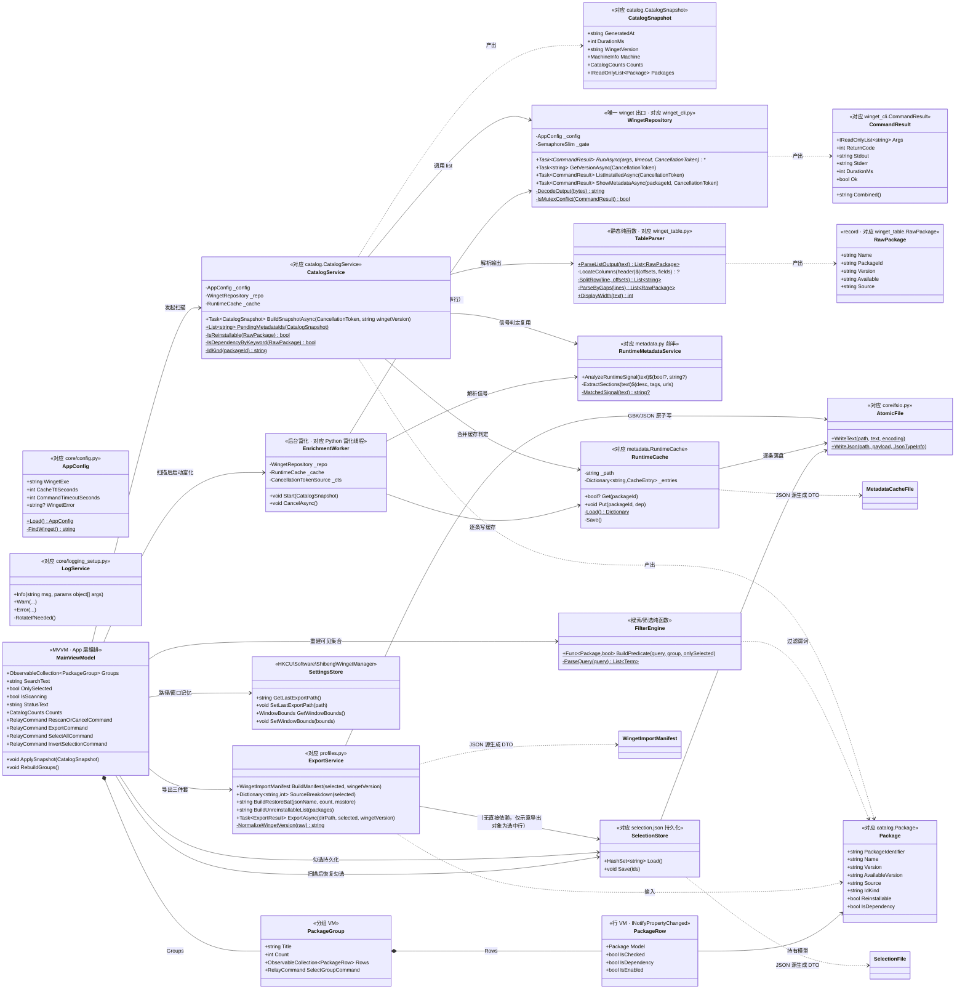
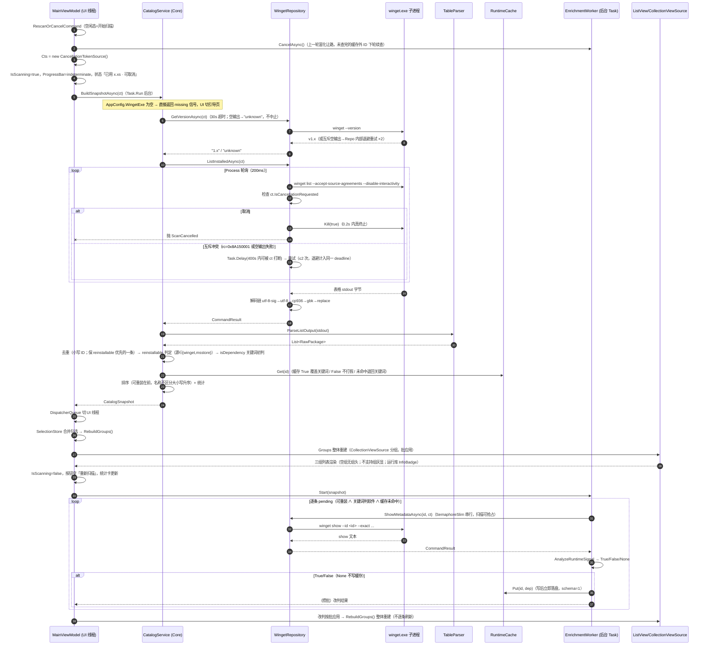
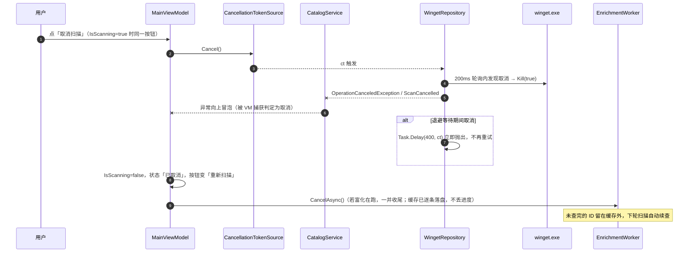
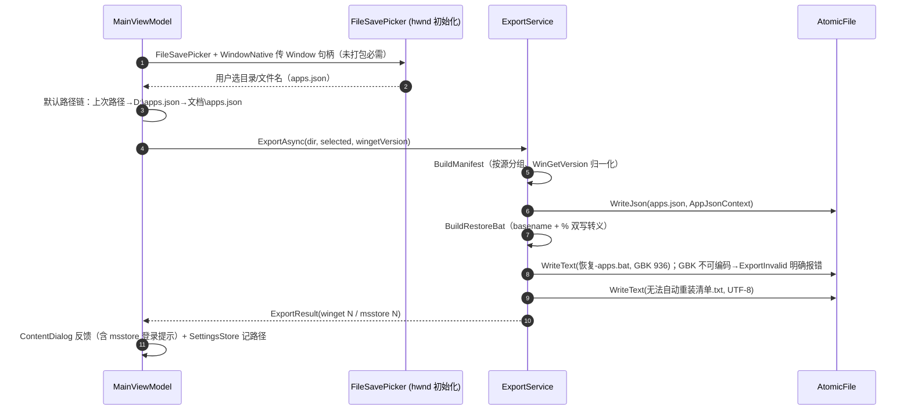
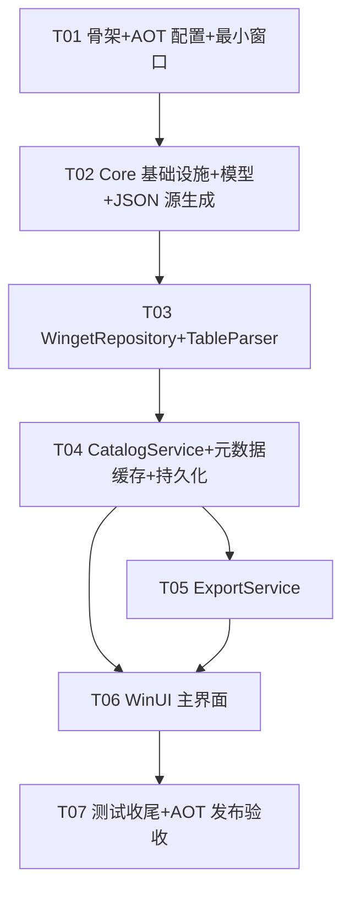

# 系统设计文档：Winget 软件管家（WinUI 3 重写版）

> 输入：`docs/PRD.md` + 原 PySide6 项目（`winget-manager`）业务口径。
> 目标：功能与判定口径与 Python 版 1:1 对等，Native AOT 单 exe 分发。

---

## Part A · 系统设计

### 1. 实现方案与框架选型

#### 1.1 核心技术挑战

| 挑战 | 应对 |
|---|---|
| WinUI 3 + Native AOT 组合 | Windows App SDK 自 **1.6 起支持 Native AOT（1.7+ 稳定）**；XAML 编译期 `x:Bind` + CsWinRT 源生成的 WinRT 投影全程 AOT 安全。T01 的验收标准就是「`dotnet publish -r win-x64 -p:PublishAot=true` 能产出可运行单 exe」，把最大风险放在第一天验证 |
| winget 表格按「显示宽度」切列（汉字占 2 列） | 纯逻辑层移植 `services/winget_table.py` → `TableParser.cs`，`char.GetUnicodeCategory` + East Asian Width 判宽，零依赖、xUnit 全覆盖 |
| 0.2s 内真正终止 winget 子进程 | `Process` + `Task.Delay` 轮询循环替代 `Process.WaitForExit`；取消即 `Kill(true)`，复刻 Python `Popen + communicate(timeout=_POLL_S)` 的语义 |
| winget 进程级全局互斥（退出码 `0x8A150001` / 空输出失败） | `WingetRepository.RunAsync` 内置退避重试（最多 2 次 × 0.4s，退避计入同一总超时预算），取消可打断退避等待 |
| 编码链 utf-8-sig → utf-8 → cp936 → gbk → 容错 | .NET 默认不含 cp936/gbk 编码表：`Encoding.RegisterProvider(CodePagesEncodingProvider.Instance)`（AOT 兼容，PRD Q4 已裁定） |
| GBK 写 bat、JSON 持久化 | bat 用 `Encoding.GetEncoding(936)` 写盘；JSON 全部走 System.Text.Json 源生成器，禁反射序列化 |
| 元数据「后台富化 + 让路/续传」 | 单一后台 Task + 顶层 CTS；`winget show` 与扫描共用同一 `WingetRepository`（进程内 `SemaphoreSlim(1,1)` 串行化，不主动撞互斥）；缓存逐条落盘，未完成 ID 下轮续查 |
| 未打包应用拿不到 `ApplicationData.LocalSettings` | 沿用注册表 `HKCU\Software\Shibeng\WingetManager`（`Microsoft.Win32.Registry`，AOT 安全），与 Python 版数据互通（PRD Q3 已裁定） |
| 未打包应用 `FileSavePicker` | `WinRT.Interop.WindowNative.GetWindowIdForWindow` + `InitializeWithWindow` 传 hwnd 初始化（CsWinRT 源生成投影，AOT 兼容） |
| 分组列表 + 批量改判不逐条刷新 | `CollectionViewSource.IsSourceGrouped` + 分组 `ObservableCollection`；改判/筛选变化时**整体重建**集合（对应原版「批应用」） |

#### 1.2 框架与库选型

| 选型 | 版本 | 理由 |
|---|---|---|
| .NET 8（`net8.0-windows10.0.19041.0`） | 8.0.x | PRD 指定；AOT 成熟度最高 |
| Windows App SDK（`Microsoft.WindowsAppSDK`） | **1.7.x（≥1.6 必需，1.6 才开始支持 Native AOT）** | WinUI 3 运行时；未打包 self-contained 需要 `WindowsAppSDKSelfContained=true` |
| `Microsoft.Windows.SDK.BuildTools` | 10.0.x latest | WinAppSDK 配套构建工具 |
| `CommunityToolkit.Mvvm` | 8.4.x | `[ObservableProperty]`/`[RelayCommand]` 为**编译期源生成**，AOT 兼容；省去手写样板 |
| `System.Text.Json`（内置 + 显式引用 8.0.x） | 8.0.x | `JsonSerializerContext` 源生成（`JsonSourceGenerationMode.Serialization \| Metadata`），反射路径归零 |
| `Microsoft.Win32.Registry` | 8.0.x | 注册表设置（AOT 安全） |
| xUnit + `Microsoft.NET.Test.Sdk` / xunit.runner.visualstudio | 2.9.x / 17.x | 测试工程；纯逻辑层不依赖 UI，普通 net8.0-windows 类库即可测 |

日志不引第三方（Serilog 等对 AOT 有反射坑面）：自写 ~100 行 `LogService`（512KB × 2 轮转），与 Python 版 `logging_setup` 等价。

#### 1.3 架构模式

三层 + MVVM：

```
┌─ WingetManager.App (WinUI 3 exe) ────── View (XAML, x:Bind) ⇄ ViewModel (MVVM Toolkit)
│
├─ WingetManager.Core (类库, 无 UI 依赖) ── Services（WingetRepository / TableParser /
│                                          CatalogService / RuntimeMetadataService /
│                                          ExportService / SelectionStore / SettingsStore）
│                                          Models / Infra（Config/Errors/AtomicFile/LogService）/ Json
│
└─ winget.exe 子进程（唯一出口：WingetRepository）
```

- **Core 不引用任何 WinUI 类型**——保证解析/判定/导出全部可 xUnit 直测；
- App 层只做「状态编排 + 渲染」，业务口径全部在 Core；
- 所有 winget 子进程调用收敛到 `WingetRepository` 一个类（对应 Python `winget_cli.py` 的「唯一入口」约定）。

---

### 2. 文件列表（相对路径）

#### 解决方案与共享配置

| 文件 | 说明 |
|---|---|
| `WingetManager.sln` | 解决方案：App + Core + Tests 三个工程 |
| `Directory.Build.props` | 全解决方案共享属性：LangVersion、Nullable、TFM 下方公共 AOT/trimming 开关说明 |
| `.editorconfig` | 统一风格（可选但建议） |
| `.gitignore` | C# 模板 |

#### Core 工程（`src/WingetManager.Core/`）

| 文件 | 说明 |
|---|---|
| `WingetManager.Core.csproj` | net8.0-windows 类库；`IsAotCompatible=true` |
| `Infra/AppConfig.cs` | 环境变量配置（`WPM_WINGET_EXE` / `WPM_CACHE_TTL` / `WPM_COMMAND_TIMEOUT`）+ `FindWinget()` 定位链（对应 `core/config.py`） |
| `Infra/AppException.cs` | `AppException` 基类 + `WingetNotFound` / `WingetCommandFailed` / `ScanCancelled` / `ExportInvalid`（对应 `core/errors.py`，去掉 HTTP status 字段） |
| `Infra/AtomicFile.cs` | 原子写盘：同目录临时文件 + fsync + `File.Replace`；`WriteText`（可指定 GBK）/ `WriteJson`（对应 `core/fsio.py`） |
| `Infra/LogService.cs` | 文件日志 `%LOCALAPPDATA%\WingetManager\logs\app.log`，512KB × 2 轮转；记录 winget 完整命令行（对应 `core/logging_setup.py`） |
| `Models/RawPackage.cs` | `winget list` 原始行：Name / PackageId / Version / Available / Source（record） |
| `Models/Package.cs` | 目录行模型：PackageIdentifier / Name / Version / AvailableVersion / Source / IdKind / Reinstallable / IsDependency（对应 `catalog.Package`） |
| `Models/CatalogSnapshot.cs` | 快照：GeneratedAt / DurationMs / WingetVersion / Machine / Counts / Packages（对应 `catalog.CatalogSnapshot`） |
| `Models/CommandResult.cs` | 子进程结果：Args / ReturnCode / Stdout / Stderr / DurationMs + `Ok` / `Combined` 属性（对应 `winget_cli.CommandResult`） |
| `Models/MetadataCacheFile.cs` | 缓存文件 DTO：`{schema, entries:{id:{dep,checkedAt}}}`，schema=1 保持与 Python 版互通 |
| `Models/SelectionFile.cs` | 勾选持久化 DTO（按包 ID 集合） |
| `Models/WingetImportManifest.cs` | `apps.json` 导出 DTO：$schema / CreationDate / Sources / WinGetVersion |
| `Json/AppJsonContext.cs` | **System.Text.Json 源生成器**：`[JsonSourceGenerationMode(Serialization \| Metadata)]`，注册 MetadataCacheFile / SelectionFile / WingetImportManifest 等全部 DTO |
| `Services/TableParser.cs` | 表格解析：显示宽度切列（汉字占 2）+ 中英表头识别 + 噪声行过滤 + 空格兜底解析（对应 `winget_table.py`，纯静态方法） |
| `Services/WingetRepository.cs` | **唯一 winget 出口**：`RunAsync`（Popen 等价：Process + 200ms 轮询取消 + kill）、互斥重试（0x8A150001 / 空输出 → 0.4s × 2）、`GetVersionAsync` / `ListInstalledAsync` / `ShowMetadataAsync`、输出解码链（对应 `winget_cli.py`） |
| `Services/CatalogService.cs` | 去重（x86/x64 保信息全的一条）、reinstallable 判定（源 ∈ {winget, msstore}）、isDependency 关键词初判 + 缓存合并（True 覆盖 / False 不打假 / 未命中退回关键词）、排序、统计（对应 `catalog.py`） |
| `Services/RuntimeMetadataService.cs` | `winget show` 输出的段落抽取（描述/标记/安装器 URL，中英+全半角冒号）+ 信号词判定（True/False/None 三态）+ 单包核查流程（对应 `metadata.py` 前半） |
| `Services/RuntimeCache.cs` | 运行库判定磁盘缓存：加载校验 schema、损坏回退空、`Get`（bool?）/`Put`（写后立即落盘）（对应 `metadata.RuntimeCache`） |
| `Services/EnrichmentWorker.cs` | 后台富化任务：取 pendingIds → 逐条 show → 解析 → 缓存；扫描让路（WingetRepository 串行）、用户重扫即取消、未查完下轮续上（对应 Python 富化线程） |
| `Services/ExportService.cs` | 三件套生成：`apps.json`（import schema 2.0、按源分组、WinGetVersion 归一化）、`恢复-apps.bat`（GBK + `chcp 936` + 管理员检查 + `%` 双写转义）、`无法自动重装清单.txt`；默认路径链 + 路径记忆（对应 `profiles.py` + 路径记忆部分） |
| `Persistence/SelectionStore.cs` | 勾选持久化 `selection.json`：原子写、损坏回退空 |
| `Persistence/SettingsStore.cs` | 注册表 `HKCU\Software\Shibeng\WingetManager`：窗口尺寸/位置、上次导出路径、键位沿用原版 |

#### App 工程（`src/WingetManager.App/`）

| 文件 | 说明 |
|---|---|
| `WingetManager.App.csproj` | TFM `net8.0-windows10.0.19041.0`；`PublishAot` / `WindowsAppSDKSelfContained` / `SelfContained` 等全部 AOT 配置（见 §1.4） |
| `app.manifest` | 兼容性声明（Win10/11）、不请求管理员权限 |
| `App.xaml` / `App.xaml.cs` | 应用入口；`CodePagesEncodingProvider` 注册 + `LogService` 初始化；`MicaBackdrop` 主题资源 |
| `MainWindow.xaml` / `MainWindow.xaml.cs` | 单页三行 Grid：顶栏（搜索/胶囊/仅看已选/全选/反选/导出）/ 分组列表 / 底栏（进度+状态+统计卡）；缺 winget 引导 StackPanel |
| `Views/PackageItemTemplate.xaml` → 内联于 MainWindow | 行模板：`CheckBox` + 名称/版本/ID + 运行库 `InfoBadge`；「不支持」组行 `IsEnabled=False` |
| `ViewModels/MainViewModel.cs` | 编排中枢：扫描命令（可取消）、筛选/搜索状态、分组集合重建、勾选持久化、导出命令、富化任务生命周期 |
| `ViewModels/PackageRow.cs` | 行 VM：`INotifyPropertyChanged`（IsChecked 等），持有 `Package` 引用 |
| `ViewModels/PackageGroup.cs` | 分组 VM：组名 / 计数 / 行集合 / 「全选本组」命令 |
| `ViewModels/CatalogFilter.cs` | 搜索词解析（多关键词 AND、`id:`/`name:` 前缀）+ 分组胶囊 + 仅看已选 的纯函数谓词（**放 Core 可测**：`Core/Services/FilterEngine.cs` 更佳——见下） |
| — | 搜索/筛选谓词实际落位：`src/WingetManager.Core/Services/FilterEngine.cs`（纯逻辑，可测；上两行仅为 UI 引用说明） |
| `Services/UiDispatch.cs` | `DispatcherQueue` 封装：后台 Task → UI 线程的统一 marshaling 入口 |
| `Properties/launchSettings.json` | F5 调试参数 |
| `Properties/PublishProfiles/win-x64.pubxml` | AOT 发布配置（PublishAot / SelfContained / WindowsAppSDKSelfContained / SingleFile 策略） |

#### 测试工程（`src/WingetManager.Tests/`）

| 文件 | 说明 |
|---|---|
| `WingetManager.Tests.csproj` | xUnit；net8.0-windows；引用 Core |
| `TableParserTests.cs` | 显示宽度切列 / 中英表头 / 噪声行 / 空格兜底 / 退化用例（从 Python 版移植断言数据） |
| `CatalogServiceTests.cs` | 去重口径、reinstallable 判定、关键词判定、缓存 True 覆盖 / False 不打假、排序 |
| `RuntimeMetadataServiceTests.cs` | 段落抽取（中英、折行、tags 列表）、三态判定、信号词大小写 |
| `RuntimeCacheTests.cs` | 落盘回读、schema 不符作废、损坏回退 |
| `ExportServiceTests.cs` | apps.json 结构与版本归一化、bat 转义（`%` 双写、basename）、GBK 不可编码报错、txt 格式 |
| `FilterEngineTests.cs` | 多关键词 AND、`id:`/`name:` 前缀 |
| `JsonContextRoundTripTests.cs` | 源生成序列化/反序列化回环（保证 AOT 路径真实可用） |
| `TestData/` | 从原项目真实 `winget list` 输出截取的样本文本（含中文表头） |

---

### 1.4 csproj 关键配置（AOT 清单）

`WingetManager.App.csproj`：

```xml
<Project Sdk="Microsoft.NET.Sdk">
  <PropertyGroup>
    <OutputType>WinExe</OutputType>
    <TargetFramework>net8.0-windows10.0.19041.0</TargetFramework>
    <TargetPlatformMinVersion>10.0.17763.0</TargetPlatformMinVersion>
    <SupportedOSPlatformVersion>10.0.17763.0</SupportedOSPlatformVersion>
    <RootNamespace>WingetManager</RootNamespace>
    <ApplicationManifest>app.manifest</ApplicationManifest>
    <UseWinUI>true</UseWinUI>
    <Platforms>x86;x64;ARM64</Platforms>
    <RuntimeIdentifiers>win-x86;win-x64;win-arm64</RuntimeIdentifiers>

    <!-- ══ Native AOT ══ -->
    <PublishAot>true</PublishAot>
    <IsAotCompatible>true</IsAotCompatible>
    <SelfContained>true</SelfContained>
    <WindowsAppSDKSelfContained>true</WindowsAppSDKSelfContained>
    <TrimMode>full</TrimMode>
    <InvariantGlobalization>false</InvariantGlobalization><!-- 必须保留中文文化感知行为 -->

    <!-- WinAppSDK AOT 必配：启用 XAML 编译期绑定路径，禁反射回退 -->
    <EnableMsixTooling>true</EnableMsixTooling>
    <WindowsPackageType>None</WindowsPackageType> <!-- 未打包 -->
    <PublishReadyToRun>false</PublishReadyToRun><!-- AOT 下无意义 -->
    <AllowUnsafeBlocks>true</AllowUnsafeBlocks> <!-- CsWinRT/WinAppSDK AOT 需要部分 unsafe 互操作 -->
  </PropertyGroup>
  <ItemGroup>
    <PackageReference Include="Microsoft.WindowsAppSDK" Version="1.7.*" />
    <PackageReference Include="Microsoft.Windows.SDK.BuildTools" Version="10.0.*" />
    <PackageReference Include="CommunityToolkit.Mvvm" Version="8.4.*" />
    <PackageReference Include="Microsoft.Win32.Registry" Version="8.0.*" />
  </ItemGroup>
</Project>
```

**AOT 兼容策略清单（横切约定，写进 `Directory.Build.props` 注释 + 代码评审检查项）**：

1. **UI 绑定一律 `x:Bind`**；`{Binding}`、`StaticResource` 之外的反射型资源查找、`XamlReader.Load`（带事件处理器）禁止使用。`x:Bind` 需要的事件/属性在编译期解析，AOT 安全。
2. **JSON 读写一律源生成**：所有 DTO 在 `AppJsonContext` 中用 `[JsonSerializable]` 注册；调用必须传 context（`JsonSerializer.Serialize(payload, AppJsonContext.Default.Xxx)`），全局禁用无 context 的重载。`NumberHandling`/命名策略等在 attribute 上声明（源生成不支持运行时 options 注入）。
3. **禁反射 API**：`dynamic`、`Activator.CreateInstance`、`Assembly.Load`、`Type.GetType(string)`、`BindingFlags` 扫描——CI/PR 中 grep 检查。
4. **WinAppSDK 已知限制（要写明）**：
   - Native AOT 支持自 WinAppSDK **1.6** 起（experimental）、1.7+ 为推荐稳定线；低于 1.6 的包直接排除；
   - 部分 XAML 控件/属性路径存在 AOT 未覆盖面（如 `Style` 基于 `x:DataType` 之外的动态路径、`ThemeResource` 大量运行时查找在个别场景需显式 `DictionarySourceLookup` 规避）——遇到具体崩溃优先改编译期等价写法，而不是加 RD.xml；
   - 未打包 + self-contained 下 `ApplicationData.LocalSettings` 不可用 → 设置走注册表（PRD Q3 裁定）；
   - `SelectorBar` 需 WinAppSDK ≥1.5（我们用 1.7，满足）；
   - CsWinRT 投影是源生成链路，无需额外处理；但**新写 COM 互操作**（如本工程没有）需注意 `ComImport` 模式 AOT 限制——本工程只走 `WindowNative`/`InitializeWithWindow` 源生成路径，安全。
5. **编码**：`Encoding.RegisterProvider(CodePagesEncodingProvider.Instance)` 在 `App.xaml.cs` 启动时注册一次（AOT 兼容）；之后 `Encoding.GetEncoding("gbk")` / `GetEncoding(936)` 可用。**不要**用 `InvariantGlobalization=true` 来「省体积」——会丢文化感知行为。
6. **trimming**：`TrimMode=full`；反射保留仅允许出现在 JSON 源生成自动生成的注册里（不需要手写 RD.xml）。

---

### 3. 数据结构与接口（类图）

Python 层 → C# 映射：`winget_cli.WingetRepository → Services.WingetRepository`；`winget_table → TableParser`；`catalog.CatalogService → CatalogService`；`metadata.RuntimeCache/RuntimeMetadataService → RuntimeCache / RuntimeMetadataService / EnrichmentWorker`；`profiles → ExportService`；`core.config/errors/fsio/logging → Infra.*`。



---

### 4. 程序调用流程（时序图）

#### 4.1 主流程：扫描 → 解析 → 分组 → 渲染 → 后台元数据核查 → 缓存写入



#### 4.2 取消传播路径（点「取消扫描」）



#### 4.3 导出流程



---

### 5. 待明确事项（UNCLEAR）

| # | 问题 | 建议方案 |
|---|---|---|
| 1 | **单 exe 程度**：未打包 self-contained + AOT 的产物是「单 exe」还是「exe + 少量 DLL」？WinAppSDK self-contained 会带 `Microsoft.WindowsAppRuntime.*` 依赖 | 按最少改动策略：`PublishSingleFile=true` + `IncludeNativeLibrariesForSelfExtract=true` 尽量收拢；若 WinAppSDK 原生 DLL 无法全收（已知部分原生资源收不进），接受「exe + 同目录少量 DLL」并在 README 说明分发形态——PRD Q1 已写「可能附带少量自包含 DLL」，口径一致。T01 用真实 publish 验证并记录产物清单 |
| 2 | **WinAppSDK 版本钉死**：1.7 系列小版本对 AOT 修复频繁 | T01 一次锁定具体版本号（查询 NuGet 最新稳定 1.7.x）写入 csproj，不做浮动 `1.7.*`——AOT 行为对版本敏感，钉死避免「昨天能编译今天报错」 |
| 3 | **组头吸顶（PRD Q3/Q3-P1-1）**：WinUI 3 ListView 分组头无粘性支持 | P0 用标准 `GroupStyle.HeaderTemplate`，吸顶 P1 用 ItemsRepeater + 自定义布局。不额外设计 |
| 4 | **`SelectorBar` vs ToggleButton**：SelectorBar 需 WinAppSDK 1.5+，样式定制自由度低 | 用 1.7 SDK 自带 SelectorBar；若遇到 AOT 边缘问题，降级为一组 ToggleButton（单选语义手写），接口不变 |
| 5 | **RichEdit/InfoBadge 主题适配**：运行库角标/灰显样式在深浅色下需手工配色 | 用 ThemeResource（`SystemFillColorAttentionBrush` 等）而非硬编码色；P1-6 验收时对照深浅两主题截图 |
| 6 | **metadata-cache 兼容性**：Python 版与 C# 版同一路径同名文件，schema 均为 1 | 保持 `{schema:1, entries:{id:{dep,checkedAt}}}` 完全一致，两版本互换无损——测试工程加一条与 Python 版样例文件的互通断言 |
| 7 | **「已用时间提示」刷新频率**：原版用 QTimer；WinUI 版用什么计时器 | `DispatcherQueueTimer`（UI 线程 100ms tick 只更新一个 TextBlock，开销可忽略），扫描计时与 `Stopwatch` 取真值 |
| 8 | **Ctrl+A 快捷键与 TextBox 焦点冲突（P1-4）** | 键盘事件挂 Window 层 `KeyboardAccelerator`，TextBox 有焦点时短路——实现细节在 T06，风险低 |

---

## Part B · 任务分解

### 6. 依赖包（NuGet）

```
# App 工程
- Microsoft.WindowsAppSDK@1.7.x（T01 钉死具体版本；Native AOT 需 ≥1.6，1.7+ 稳定）
- Microsoft.Windows.SDK.BuildTools@10.0.x latest
- CommunityToolkit.Mvvm@8.4.x（源生成，AOT 兼容）
- Microsoft.Win32.Registry@8.0.x（注册表设置）

# Core 工程
- System.Text.Json@8.0.x（显式引用，源生成 JsonSerializerContext）
- Microsoft.Win32.Registry@8.0.x

# Tests 工程
- Microsoft.NET.Test.Sdk@17.x
- xunit@2.9.x
- xunit.runner.visualstudio@2.8.x
```

### 7. 任务列表（按依赖排序）

| Task ID | 任务名 | Source Files（创建/修改） | 依赖 | 优先级 |
|---|---|---|---|---|
| **T01** | **解决方案骨架 + AOT 配置 + 可编译最小 WinUI 3 窗口**<br>验收：`dotnet publish -c Release -r win-x64`（PublishAot=true）产出可运行单 exe，空窗口能启动 | `WingetManager.sln`、`Directory.Build.props`、`.gitignore`、`.editorconfig`、`src/WingetManager.App/WingetManager.App.csproj`（全部 AOT/csproj 配置见 §1.4）、`src/WingetManager.App/app.manifest`、`src/WingetManager.App/App.xaml(.cs)`（含 CodePagesEncodingProvider 注册）、`src/WingetManager.App/MainWindow.xaml(.cs)`（最小空窗口）、`src/WingetManager.App/Properties/launchSettings.json`、`src/WingetManager.App/Properties/PublishProfiles/win-x64.pubxml`、`src/WingetManager.Core/WingetManager.Core.csproj`（空壳）、`src/WingetManager.Tests/WingetManager.Tests.csproj`（空壳）、**锁死 WinAppSDK 版本** | — | P0 |
| **T02** | **Core 基础设施 + 模型 + JSON 源生成器**（配置/错误/原子写/日志/全部 DTO） | `src/WingetManager.Core/Infra/AppConfig.cs`、`Infra/AppException.cs`、`Infra/AtomicFile.cs`、`Infra/LogService.cs`、`Models/RawPackage.cs`、`Models/Package.cs`、`Models/CatalogSnapshot.cs`、`Models/CommandResult.cs`、`Models/MetadataCacheFile.cs`、`Models/SelectionFile.cs`、`Models/WingetImportManifest.cs`、`Json/AppJsonContext.cs` | T01 | P0 |
| **T03** | **winget 仓储层 + 表格解析**（子进程/取消/互斥重试/编码链/显示宽度切列） | `src/WingetManager.Core/Services/WingetRepository.cs`、`Services/TableParser.cs`、`src/WingetManager.Tests/TableParserTests.cs`、`TestData/*`（从原项目截取真实输出样本） | T02 | P0 |
| **T04** | **目录服务 + 元数据核查与缓存 + 持久化**（分组判定口径 1:1） | `src/WingetManager.Core/Services/CatalogService.cs`、`Services/RuntimeMetadataService.cs`、`Services/RuntimeCache.cs`、`Services/EnrichmentWorker.cs`、`Services/FilterEngine.cs`、`Persistence/SelectionStore.cs`、`Persistence/SettingsStore.cs`、`src/WingetManager.Tests/CatalogServiceTests.cs`、`RuntimeMetadataServiceTests.cs`、`RuntimeCacheTests.cs`、`FilterEngineTests.cs`、`JsonContextRoundTripTests.cs` | T03 | P0 |
| **T05** | **导出服务**（apps.json + 恢复 bat + txt 三件套，字节级兼容） | `src/WingetManager.Core/Services/ExportService.cs`、`src/WingetManager.Tests/ExportServiceTests.cs` | T04 | P0 |
| **T06** | **WinUI 主界面全量实现**（三行布局 + 分组列表 + 筛选/勾选/取消/导出/引导页/统计卡/Mica） | `src/WingetManager.App/MainWindow.xaml(.cs)`（全量重写）、`App.xaml(.cs)`（Mica/主题资源）、`ViewModels/MainViewModel.cs`、`ViewModels/PackageRow.cs`、`ViewModels/PackageGroup.cs`、`Services/UiDispatch.cs` | T04, T05 | P0 |
| **T07** | **测试收尾 + AOT 发布验收**（跑通全测 + 发布产物行为核对） | 补充 `src/WingetManager.Tests/`（Python 版行为回归用例：互斥重试、取消、编码回落——用假 exe/桩脚本模拟 winget）、修复回归、`win-x64.pubxml` 最终核对、`docs/ARCHITECTURE.md` 产物清单更新 | T06 | P0 |

> T07 说明：互斥/取消这类真实 winget 行为不强制自动化——提供「假 winget」cmd 脚本（可控退出码/延迟/输出）供手动验收 + 少量单元断言（解码链、冲突判定函数）；其余口径用纯逻辑测试覆盖。

### 8. 共享知识（跨文件约定）

1. **命名**：C# 标准 PascalCase；但**对外 JSON 字段名与 Python 版完全一致**（`schema` / `entries` / `dep` / `checkedAt` / `PackageIdentifier` / `WinGetVersion` 等）——DTO 上用 `JsonPropertyName` 显式标注，禁止靠命名策略隐式转换。
2. **JSON 源生成器注册约定**：任何新 DTO 必须加进 `AppJsonContext` 的 `[JsonSerializable]` 列表；读写调用必须带 context（`AppJsonContext.Default.Xxx`）；不满足时 CI grep 报错。
3. **x:Bind 约定**：所有 XAML 数据展示/命令绑定用 `x:Bind`（函数绑定允许）；`{Binding}` / `DataContext` 反射路径禁止；`x:Bind` 需要 `Mode=OneWay` 时 VM 属性必须 `INotifyPropertyChanged`（CommunityToolkit `[ObservableProperty]`）。
4. **线程模型**：winget 子进程/文件 IO 一律在后台 Task（`Task.Run` / async）；任何触 UI 的回调经 `UiDispatch`（`DispatcherQueue.TryEnqueue`）；VM 只在 UI 线程改 `ObservableCollection`；`EnrichmentWorker` 是唯一长生命周期后台任务，由 VM 持有顶层 CTS 统一取消。
5. **winget 唯一出口**：除 `WingetRepository` 外任何类不得启动子进程；`SemaphoreSlim(1,1)` 保证扫描与富化的 show 串行（不主动撞 winget 全局互斥）。
6. **错误口径**：Core 层抛 `AppException` 派生异常（`ScanCancelled` 用 `OperationCanceledException` 语义）；App 层 VM 捕获后转状态栏文案，不让异常冒到全局 handler 崩溃（缺 winget/缓存损坏均「降级继续」）。
7. **路径**：数据目录 `%LOCALAPPDATA%\WingetManager\`（cache / selection.json / logs\app.log）；注册表键 `HKCU\Software\Shibeng\WingetManager` 沿用原键名。
8. **缓存/持久化写盘**：一律走 `AtomicFile`（临时文件 + fsync + Replace）；bat 写盘必须 GBK + CRLF。

### 9. 任务依赖图



### 10. 实现落地记录（T01–T07 与设计的差异）

| # | 设计/文档原口径 | 实际落地 | 原因 |
|---|---|---|---|
| 1 | §5 UNCLEAR#1：`PublishSingleFile` + 收拢原生 DLL | **放弃单文件**，接受「exe + WinAppSDK 自包含 DLL」（win-x64 共约 130 MB，其中 exe 约 10 MB） | Native AOT 与 `PublishSingleFile` 互斥（SDK 明确报错，见 §1.4） |
| 2 | §5 UNCLEAR#2：钉死 WinAppSDK 版本 | `Microsoft.WindowsAppSDK 1.7.251107005`（已钉死） | AOT 对小版本敏感 |
| 3 | P0-21：运行库角标用 `InfoBadge` | 等价视觉的文本徽标（Border + TextBlock「运行库」） | `InfoBadge` 只支持数字/图标，不支持任意文本 |
| 4 | AOT 策略 1：布尔 → Visibility 转换 | `{x:Bind app:UiConverters.VisibleIf(...)}` 静态函数绑定 | `IValueConverter` 走 `StaticResource` 运行时查找，AOT 高风险面 |
| 5 | §2 文件列表：`ViewModels/CatalogFilter.cs` | 谓词落位 `Core/Services/FilterEngine.cs`（文档已注明） | 纯逻辑可测 |
| 6 | 本机 AOT 链接 | `IlcUseEnvironmentalTools=true` + 手工拼 MSVC/SDK 环境变量 | `vswhere`/`vcvarsall.bat` 依赖 reg.exe，在受限环境不可用；正常开发机无需此参数 |
| 7 | — | 导出按钮防重入（`CanExport`）、Ctrl+A 检测搜索框焦点、窗口越界钳制、`FileSavePicker` 失败回退默认路径确认 | 交互健壮性补强，语义与 PRD 一致 |
| 8 | §5 UNCLEAR#1 结论 | **原生单文件不可行** → 改用 **7-Zip SFX 自解压安装器**，产物 `dist/WingetManager-3.0.0-win-x64-sfx.exe`（16.8 MB，载荷 72 MB） | `PublishAot` 与 `PublishSingleFile` 互斥；且单文件 Bundler 需要托管 host，AOT 产物没有。`7zSD.sfx` 才实现 `<InstallPath>/<RunProgram>` 安装器管线（`7z.sfx`/`7zCon.sfx` 不支持） |
| 9 | 图标 | `Assets/app.ico`（16–256 共 7 档）+ `<ApplicationIcon>` + `AppWindow.SetIcon` + 顶栏 `ms-appx:///Assets/app-512.png`；SFX 图标由 `packaging/retarget-sfx-icon.py` 做 PE 资源手术替换 | 三处（exe 资源 / 标题栏·任务栏 / 界面）与安装器图标统一 |
| 10 | 构建脚本 | `packaging/build-dist.sh` 用 vswhere + 版本排序自动探测 MSVC/WinSDK，publish 走 `-o dist/.stage/app`，支持 `--skip-publish` 只重打包 | 换机不用改脚本；探测与验证细节见 `docs/QA-REPORT-icon-pack.md` §10.9 |

#### 10.1 构建与分发命令

```bash
# 1. 日常开发（不需要 AOT）
dotnet build WingetManager.sln -c Release

# 2. 出单文件安装包（AOT publish + SFX 打包，约 1.5 分钟）
bash packaging/build-dist.sh

# 3. 只重打包（已 publish 过，改完 install.cmd / sfx-config.txt 时用）
bash packaging/build-dist.sh --skip-publish
```

产物 `dist/WingetManager-<版本>-win-x64-sfx.exe`：**双击即用，无确认框**
（`sfx-config.txt` 里不配 `BeginPrompt`）——

1. 解压到临时目录，`install.cmd` 先读载荷里的 `version.txt` 与安装目录里的同名文件比对；
2. **版本一致 → 快速路径**：不 `taskkill`、不 `robocopy`，直接 `start` 安装目录里的 exe，
   所以第二次起双击同一个 exe 等同于"打开应用"（毫秒级）；
3. **版本不同 / 未安装 → 完整路径**：`taskkill` 旧实例 → 删遗留 `install.cmd` 与 `*.pdb` →
   `robocopy /e /purge` 到 `%LOCALAPPDATA%\Programs\WingetManager` → 启动 → 清理临时目录；
4. 升级失败（robocopy `errorlevel >= 8`）时不启动，改为打开日志。

载荷里不含 `WingetManager.pdb`（AOT 调试符号 58 MB，占原载荷 45%），
`install.cmd` 的 `/xf *.pdb` + 显式 `del` 会把旧安装里的 pdb 一并清掉。
